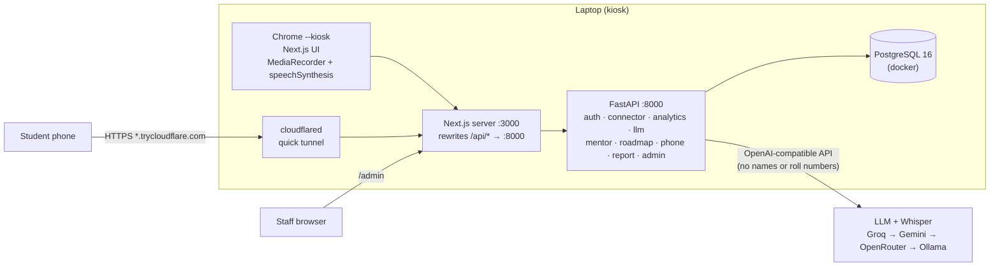
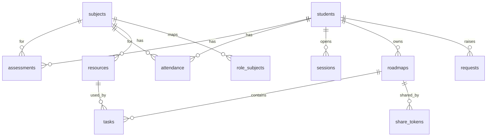
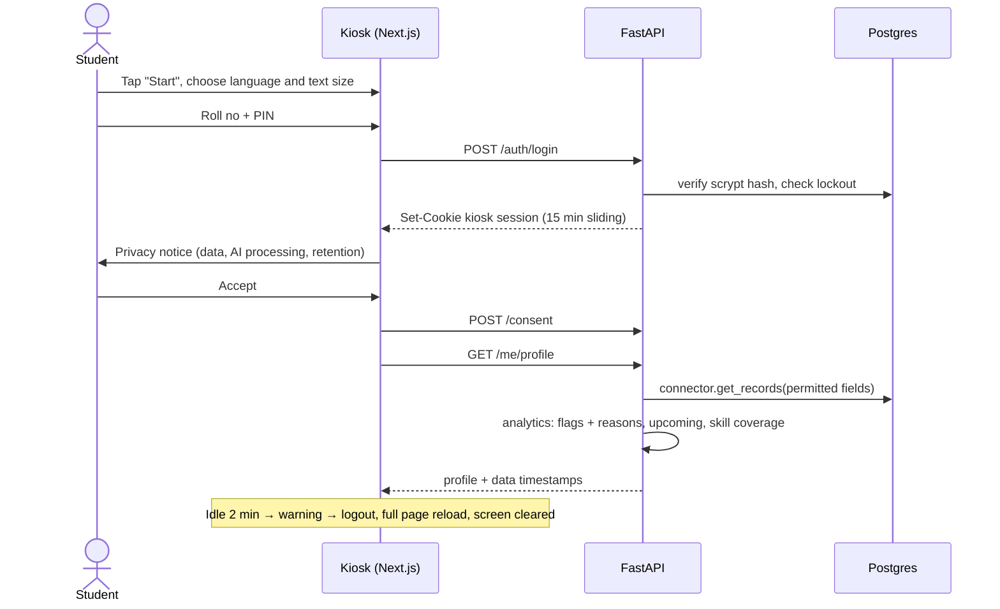
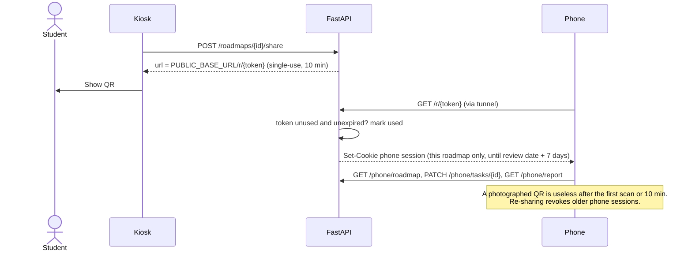

# AI Smart Student Mentor Display — High-Level Design

| | |
|---|---|
| Project | AI Smart Student Mentor & Career Guidance Display (Trialshopy) |
| Document | High-Level Design (HLD) and technical requirements |
| Version | 1.1 — 10 Nov 2026 |
| Prepared by | _<name>_ |
| Submission | 13 Nov 2026 |
| Scope | MVP demo on synthetic data; a laptop acts as the kiosk |
| Detailed design | `docs/LLD.md` (component contracts, schema, prompts, tests) |

---

## 1. Goals and scope

The system delivers the core mentoring loop from the brief (§16): **sign in → academic diagnosis → mentor conversation → personalised roadmap → phone access via QR → progress report**, with human escalation available at every step.

### 1.1 In scope

| # | Requirement (brief) | Delivered by |
|---|---|---|
| M1 | Kiosk welcome and student authentication (§16 must) | `auth`, kiosk session, idle logout |
| M2 | Academic data import with validation (§16 must, §6-C) | `connector` (controlled data import) |
| M3 | Subject-wise analysis with explained evidence (§16 must) | `analytics` rule engine |
| M4 | AI mentor conversation, text and voice, English and Hindi (§16 must) | `mentor`, `llm`, browser audio + Whisper STT, browser TTS |
| M5 | Personalised roadmap: topics, tasks, resources, deadlines, review date (§16 must, §8) | `roadmap` |
| M6 | QR / PDF access via a time-limited secure link (§16 must) | `roadmap` share + `phone` + print-to-PDF |
| M7 | Progress report, verified marks kept apart from self-reported activity (§16 must, §10) | `report` |
| S1 | Faculty/admin dashboard: aggregates, metrics, intervention queue, audit (§16 should) | `admin` |
| S2 | Career skill-coverage indicator per role, no predictions (§9) | `analytics` readiness + mentor context |

### 1.2 Out of scope

| Item | Reason |
|---|---|
| Kiosk hardware, camera, proximity sensor | Laptop + browser kiosk mode stands in; brief §13 is site-dependent |
| Face recognition, emotion or facial-cue inference | Prohibited by brief §14–15 |
| Palmistry | Brief §15: "the safest MVP is to exclude palm scanning" |
| University SSO, live SIS/LMS/ERP API | Needs institutional approvals (brief §20); replaced by data import behind the same interface |
| Advanced career matching, mock interviews, resume review | Brief §16 "later phase" |
| Reminders, native mobile app, faculty sharing of student plans | Brief §8 opt-in reminders and §23 future work; plans are student-only in the MVP |

---

## 2. Architecture

### 2.1 Deployment view



Key decisions:

- **One backend process, one database.** Modules are Python files inside one FastAPI app and communicate only through function calls and the DB, so any of them can be split out later.
- **Single origin.** Next.js `rewrites` proxy `/api/*` to FastAPI: plain httpOnly cookies, no CORS, no JWT.
- **One tunnel.** Only port 3000 is exposed; the phone reaches UI and API through it. Quick tunnels need no domain or account. Fallback: the laptop joins the presenter's phone hotspot and the LAN IP is used.
- **AI is a tool, not an agent.** The server assembles verified facts and approved resources before each call; the model only phrases replies and drafts plans. No tool calling, so it works the same on every free provider and cannot reach data it should not.

### 2.2 Technology stack (maps to brief §12)

| Brief §12 layer | Choice | Notes |
|---|---|---|
| Kiosk frontend | Next.js (App Router, TypeScript, Tailwind) | Lock-down via `chrome --kiosk`; phone view and admin are routes in the same app |
| Backend API | Python FastAPI, managed with `uv` | Same language as the analytics engine |
| University integration | Controlled data import (CSV → Postgres) via `connector.py`, with row-level validation and an import log | Brief §12 allows "controlled data import"; a live API replaces this one module |
| Data storage | PostgreSQL 16 with retention rules | No object storage: PDFs are rendered on demand, never stored (data minimisation) |
| AI orchestration | OpenAI Python SDK against any OpenAI-compatible endpoint, ordered fallback | Retrieval = SQL lookup on approved `resources`; policy prompt; Pydantic-validated output; metadata-only logging |
| Speech | STT: browser `MediaRecorder` → `/audio/transcriptions` (Whisper, same client). TTS: browser `speechSynthesis` | English (`en-IN`) and Hindi (`hi-IN`); language chosen on the welcome screen |
| Analytics engine | Pure Python rule functions | Interpretable: every flag carries a reason and the number of assessments behind it |
| Roadmap/report engine | Pydantic schemas, rule-checked plans, `qrcode.react`, print CSS → "Save as PDF" | |
| Monitoring | stdlib JSON logging, `/api/healthz`, `audit_log`, admin metrics | Kiosk polls health and shows an offline help screen |

### 2.3 Backend modules

| Module | Responsibility |
|---|---|
| `main.py` | App, router wiring, request logging, health |
| `db.py` | Connection pool, schema, audit helper, retention cleanup |
| `schemas.py` | Shared request/response models (mirrored in the web app) |
| `auth.py` | PIN login + lockout, sessions (kiosk, phone, staff), consent, student requests, feedback, plan deletion |
| `connector.py` | CSV import with validation; record access; the only module that knows the data source |
| `analytics.py` | Flags with reasons, upcoming assessments, career skill coverage, `/me/profile` |
| `llm.py` | Provider fallback; chat, validated JSON, transcription |
| `mentor.py` | Grounded context (no identifiers), system prompt, chat and STT endpoints |
| `roadmap.py` | Draft generation, plan rules, save with baseline snapshot, share tokens |
| `phone.py` | Token exchange, phone roadmap / report, task status |
| `report.py` | Baseline vs review comparison, self-reported progress, overdue tasks |
| `admin.py` | Aggregates, §19 metrics, intervention queue, audit view |

---

## 3. Data model



| Table | Purpose | Notes |
|---|---|---|
| `students` | Identity for sign-in | PIN stored as scrypt hash; lockout counters |
| `subjects` | Course catalogue | |
| `assessments` | Marks by topic, kind, date, batch | `batch` ∈ {baseline, review}; blank score = missing (past) or upcoming (future); duplicates rejected by a unique key |
| `attendance` | Attended / total per subject and batch | |
| `resources` | Approved learning content used for retrieval | |
| `role_subjects` | Career role → required subjects | Drives the skill-coverage indicator |
| `imports` | Import log with counts and rejected rows | Data timestamps and validation evidence |
| `sessions` | Kiosk, phone and staff sessions | Only the SHA-256 of the cookie is stored; consent recorded per kiosk session; phone sessions scoped to one roadmap |
| `roadmaps` | Saved plans with versioning | `evidence` = baseline snapshot computed by the server at save time |
| `tasks` | Plan tasks | Day range, due date, kind (learn / practice / checkpoint), reason, effort, resource, completion check, status (pending / partial / done) |
| `share_tokens` | QR links | Single-use, 10-minute expiry |
| `requests` | Human-mentor referrals and data-correction requests | Admin intervention queue |
| `feedback` | Anonymous post-session rating | Brief §19 usefulness metric |
| `audit_log` | Security and usage events | Retained 180 days |

**Not stored:** chat transcripts (client memory only, for the session), audio, camera data, raw prompts or model replies.

---

## 4. API

All routes are under `/api`. Full request/response models are in LLD §C1.5.

| Method | Path | Purpose | Auth |
|---|---|---|---|
| GET | `/healthz` | DB status and last LLM success/error | none |
| POST | `/auth/login` | Roll no + PIN → kiosk session (15 min sliding); 5 failures lock 5 min | none |
| POST | `/auth/logout` | End session | kiosk |
| POST | `/consent` | Record consent for the shown notice version | kiosk |
| GET | `/me/profile` | Records, flags with reasons, upcoming assessments, skill coverage, data timestamps | kiosk + consent |
| DELETE | `/me/plans` | Delete the student's saved plans | kiosk + consent |
| POST | `/requests` | Human-mentor referral or data-correction request | kiosk + consent |
| POST | `/feedback` | Anonymous 1–5 rating at session end | kiosk |
| POST | `/stt` | Audio + language → text | kiosk + consent |
| POST | `/mentor/chat` | Messages + language → reply | kiosk + consent |
| POST | `/roadmaps/draft` | Subject, days, minutes/day, review date, conversation → validated draft (not saved) | kiosk + consent |
| POST | `/roadmaps` | Save the student-reviewed plan | kiosk + consent |
| GET | `/roadmaps` | List the student's plans | kiosk + consent |
| GET | `/roadmaps/{id}` | Plan with tasks and resources | kiosk (owner) |
| POST | `/roadmaps/{id}/share` | New QR link; revokes older phone sessions | kiosk (owner) |
| GET | `/roadmaps/{id}/report` | Progress report | kiosk (owner) |
| GET | `/r/{token}` | Exchange QR token → phone session | token |
| GET | `/phone/roadmap` | Plan for the phone | phone |
| GET | `/phone/report` | Progress report for the phone | phone |
| PATCH | `/phone/tasks/{id}` | Task status (self-reported) | phone (scoped) |
| POST | `/admin/login` | Staff password → staff session | none |
| GET | `/admin/summary` | Aggregates (groups < 5 suppressed), metrics, requests, health, audit | staff |
| POST | `/admin/requests/{id}/close` | Close a request | staff |

---

## 5. Key flows

### 5.1 Kiosk session



### 5.2 Mentor conversation and roadmap

```mermaid
sequenceDiagram
    actor S as Student
    participant K as Kiosk
    participant A as FastAPI
    participant L as LLM provider
    S->>K: Speak (hold-to-talk)
    K->>A: POST /stt (audio, lang)
    A->>L: /audio/transcriptions (Whisper)
    L-->>A: text
    A-->>K: text (shown, editable)
    K->>A: POST /mentor/chat (messages)
    A->>A: context = verified flags + upcoming + approved resources (no identifiers)
    A->>L: chat.completions
    A-->>K: reply → caption + speechSynthesis
    S->>K: "Create my plan" (subject, days, minutes/day, review date)
    K->>A: POST /roadmaps/draft
    A->>L: chat.completions (JSON-only prompt)
    A->>A: validate: schema, approved resources, day coverage, time budget, checkpoints; retry once
    A-->>K: draft
    S->>K: Edit, then Save
    K->>A: POST /roadmaps
    A->>A: re-validate, snapshot baseline evidence, compute due dates
```

### 5.3 QR hand-off to the phone



### 5.4 Progress review

At the review date the student signs in again (at the kiosk, or opens the phone link). For the demo, a `review` batch is imported (`uv run python -m app.connector import seed --batch review`). The report contains:

| Section | Source | Rule |
|---|---|---|
| Plan reference | `roadmaps` | Roll no, programme, plan version, start and review dates |
| Baseline | `roadmaps.evidence` | Exactly the evidence used to create the plan |
| **Verified change** | `assessments` baseline vs review | Compared only for the same topic and assessment kind; otherwise "no comparable assessment yet" |
| **Self-reported activity** | `tasks.status` | Done / partial / pending and overdue tasks, in a visually separate block |
| Remaining gaps | Analytics re-run on the review batch | |
| Next actions | Remaining gaps | New plan; human mentor offered when gaps remain |
| Caveat | Static | "They do not show that the plan caused the change." |

Kiosk and phone both offer "Save as PDF" through the browser's print dialog.

---

## 6. Academic analytics

Pure functions over the student's records and class averages. Thresholds live in one `RULES` dict so faculty can tune them (brief §16: "configured performance gaps").

| Flag | Rule (default) | Example reason shown to student |
|---|---|---|
| `LOW_VS_SELF` | Subject % < student's overall % − 10 | "Data Structures average 54% vs your overall 70%" |
| `LOW_VS_CLASS` | Subject % < class mean − 10 | "Data Structures 54% vs class average 66%" |
| `DECLINING` | ≥ 4 quizzes; mean of last 2 < mean of first 2 − 10 | "Quiz scores fell from 70% to 48%" |
| `LOW_ATTENDANCE` | Attendance < 75% | "Attendance 68% (41 of 60 classes)" |
| `MISSING` | Past assessment with no score | "Internal on 2026-10-10 has no recorded score" |
| `WEAK_TOPIC` | Topic % < 50 within a flagged subject | "Graphs: 40% across 2 assessments" |

Every flag carries `{code, subject, topic?, values (incl. n), reason}`. The UI shows reasons, the number of assessments behind them, and when the data was recorded and imported. **Skill coverage** per career role is the mean of the student's marks in that role's subjects, labelled as an indicator, never a prediction. The LLM receives these results; it never computes numbers.

---

## 7. AI design

### 7.1 Provider abstraction

`llm.py` wraps the OpenAI SDK. Providers are an ordered list from env; on any API error, timeout or empty reply the next provider is tried immediately (SDK retries disabled).

```
LLM_PROVIDERS=groq,gemini,openrouter,ollama
GROQ_BASE_URL=https://api.groq.com/openai/v1      GROQ_MODEL=...   GROQ_API_KEY=...
GEMINI_BASE_URL=https://generativelanguage.googleapis.com/v1beta/openai/   ...
OPENROUTER_BASE_URL=https://openrouter.ai/api/v1  ...
OLLAMA_BASE_URL=http://localhost:11434/v1         ...   (offline fallback)
STT_PROVIDER=groq   STT_MODEL=whisper-large-v3
```

Use non-reasoning chat models (reasoning models can spend the token budget on hidden reasoning and return nothing). Free-tier limits change often; verify them on each provider dashboard when creating keys.

### 7.2 Grounded prompt

```
[SYSTEM]  Policy: supportive mentor; facts only from VERIFIED RECORDS; separate facts from student
          statements; say when data is missing or thin; one short question at a time, plain text;
          never infer feelings or ability; never promise grades, placement or salary; suggest a
          human mentor for wellbeing or sensitive issues; resources only from the approved list;
          reply in English or Hindi.
[CONTEXT] VERIFIED RECORDS (as of {date}): subjects, flags with reasons and n
          UPCOMING ASSESSMENTS
          SKILL COVERAGE BY CAREER ROLE (indicator only)
          APPROVED RESOURCES: [id] subject / topic — title
[CHAT]    last 16 messages (user / assistant roles only)
```

No name or roll number is sent to the provider.

### 7.3 Roadmap output contract

The model writes only the summary and tasks; subject, days, minutes per day and review date come from the student's form.

```json
{
  "summary": "string",
  "tasks": [
    {"day_from": 1, "day_to": 3, "kind": "learn", "topic": "Binary trees",
     "activity": "string", "reason": "Trees 55% across 2 quizzes", "minutes": 60,
     "resource_id": 12, "check": "Short concept quiz"}
  ]
}
```

Checks (LLD §C7.3): valid schema; resources from the approved list; tasks in order, non-overlapping, covering every day; effort within the daily budget; a checkpoint at least every 7 days and at the end. One retry with the error message, then "AI is busy" with the human-mentor option. On save the server re-validates, computes due dates and snapshots the baseline evidence itself.

### 7.4 Guardrails summary

- Numbers come only from `analytics`; the LLM phrases and plans.
- Resources are restricted to the approved table (no invented links).
- The student previews, edits or regenerates every plan before saving.
- "Talk to a human mentor" is always visible and creates a request in the staff queue.
- Logs record provider, model, latency and token counts, never prompt or reply content.

---

## 8. Frontend

| Route | Screen |
|---|---|
| `/` | Welcome, language (English / हिन्दी), text size, start |
| `/login` | Roll no + PIN (large keypad) |
| `/consent` | Privacy notice: data used, purpose, AI processing, who can see it, retention, alternatives |
| `/profile` | Subject summary, flags with reasons, upcoming assessments, skill coverage, data timestamps, report a data error, my plans, delete my plans |
| `/mentor` | Chat with hold-to-talk mic; captions for every spoken reply |
| `/roadmap/new` | Plan form → generated draft → edit → save |
| `/roadmap/[id]` | Plan with dates and checkpoints, QR to phone, print |
| `/report/[id]` | Progress report, print |
| `/end` | Session ended; optional 1–5 rating |
| `/r/[token]` | Phone: token exchange → `/m` |
| `/m` | Phone: plan with task status, deadlines, resources; progress report; save as PDF |
| `/admin` | Staff: aggregates, metrics, intervention queue, health, audit |

Kiosk behaviour: idle timer (2 min warning, then logout with a full page reload), back-forward cache guard, `/api/healthz` poll every 30 s with an offline help screen, large touch targets, keyboard support, text input always available alongside voice, captions for all speech.

---

## 9. Security and privacy (brief §14)

| Requirement | Implementation |
|---|---|
| Consent and transparency | Notice before any record access, every session; names the external AI processing; recorded on the session and in `audit_log` with notice version |
| Alternative sign-in | Roll no + PIN; no camera anywhere; help desk route stated on the notice |
| Data minimisation | Connector returns only permitted fields; no identifiers sent to the AI provider; no transcripts, audio or camera data stored |
| Authentication | Roll no + PIN (stand-in for student ID / SSO); scrypt hashing; 5 failures → 5-minute lockout; staff use a ≥ 12-character password |
| Access control | Every query scoped by the session's student; phone sessions limited to one plan (read, report, task status); staff see aggregates and requests only |
| Session safety | Kiosk: 15-min sliding expiry, 2-min idle logout, full reload, back-cache guard. QR tokens single-use, 10 min. Re-share revokes old phone sessions |
| Encryption in transit | HTTPS on the tunnel; kiosk traffic stays on `localhost` |
| Encryption at rest | Demo: laptop full-disk encryption. Production: encrypted managed Postgres |
| Secrets | `.env` (git-ignored), backend only |
| Retention and deletion | Sessions and tokens deleted at expiry; audit 180 days; students can delete their plans; plans cleared at semester end |
| Audit | Logins, consent, profile access, drafts, saves, shares, token use, task updates, reports, requests, admin views |
| AI reliability and fairness | §7.4; no labels; no automated academic, disciplinary or placement decisions |
| Compliance | Notice-and-consent design aligned with the DPDP Act; formal institutional privacy and security review required before live use |

Demo-only exposure: the quick tunnel makes the app publicly reachable while it runs. Every route except health, login and token exchange requires a session. Production would run on campus infrastructure behind SSO.

---

## 10. Non-functional requirements

| Area | Target (demo) |
|---|---|
| Profile load | < 500 ms |
| Mentor reply | < 4 s on the primary provider |
| Roadmap draft | < 15 s including one retry |
| STT round trip | < 3 s for a 10 s utterance |
| Concurrency | 1 kiosk + a few phones |
| Availability | Provider fallback chain; Ollama offline fallback; hotspot fallback for the tunnel |
| Accessibility | Keyboard-only journey, captions, large-text mode, touch targets ≥ 48 px |

---

## 11. Testing (brief §18)

| Area | Check |
|---|---|
| Functional | Automated API tests per component (`uv run pytest`) + manual end-to-end demo script |
| Data accuracy | Imported row counts match valid CSV rows; unknown ids, out-of-range scores and duplicates are rejected and reported |
| Analytics | Each rule fires at and does not fire just past its threshold; upcoming vs missing |
| Recommendation quality | Plan rule checks (resources, coverage, budget, checkpoints); faculty review of sample plans |
| Privacy / security | Lockout; consent gate; student A cannot read student B's data; phone cookie cannot reach kiosk routes; used / expired QR rejected; re-share revokes; no identifiers in the AI prompt; plan deletion |
| Report integrity | Self-reported task status never changes verified figures; non-comparable assessments are not compared |
| Usability | Keyboard-only and touch-only journeys; English and Hindi voice round trip |
| Performance | Measured against §10 during rehearsal |

---

## 12. Synthetic data

A seeded generator (fixed random seed, reproducible): 30 students of B.Tech CSE semester 3; five subjects (Data Structures, Database Systems, Operating Systems, Computer Networks, Discrete Mathematics) with five topics each; topic quizzes, internal tests, one upcoming internal, attendance; 50 approved resources with verified links; four career roles mapped to subjects. Designed cases: the demo student `CS23001` mirrors the brief's example (weak in Trees and Graphs, falling quiz trend); one student with low attendance; one with a missing mark. A `review` batch shows partial improvement for the report.

---

## 13. Running the demo

```bash
cp .env.example api/.env                         # add provider keys + ADMIN_PASSWORD
cd api && uv run python -m app.connector import seed --batch baseline && cd ..
./scripts/dev.sh                                 # Postgres, tunnel (sets PUBLIC_BASE_URL), API, web
google-chrome --kiosk --user-data-dir=$HOME/.emon-kiosk http://localhost:3000
# at "review time":
cd api && uv run python -m app.connector import seed --batch review
```

---

## 14. Risks

| Risk | Mitigation |
|---|---|
| Free-tier LLM limits hit during the demo | Ordered provider fallback; Ollama local fallback |
| Tunnel or venue Wi-Fi fails | Phone-hotspot LAN fallback; tested on day 1 |
| LLM returns an invalid plan | Rule checks + one retry with the error; human-mentor fallback |
| Hindi TTS voice missing on the laptop | Checked on day 2; captions always shown |
| Library noise hurts STT | Hold-to-talk, editable transcript, text input |
| Real university data unavailable | Synthetic data behind the connector interface (brief §20) |
| Inaccurate records | Validation on import, data timestamps on screen, correction requests to staff |
| Previous student's data visible on a shared kiosk | Idle logout, full reload, back-cache guard, no data in browser storage |

---

## 15. Build plan

| Date | Deliverables |
|---|---|
| 11 Nov | Contracts and scaffold (schema, shared models, stub routes, web shell, tooling); tunnel test on a phone; auth, connector + seed, analytics, LLM gateway, voice, static screens, each with tests |
| 12 Nov | Mentor chat, roadmap draft → edit → save, QR share and phone view, kiosk screens wired to data |
| 13 Nov | Report, admin, end-to-end rehearsal (twice), submission of report and demo |

---

## 16. Upgrade paths (post-assignment)

| Demo choice | Production replacement | Change confined to |
|---|---|---|
| CSV data import | University SIS/LMS/ERP REST API | `connector.py` |
| Roll no + PIN | University SSO (OIDC/SAML) or ID-card / QR sign-in | `auth.py` |
| Browser print PDF | Server-side PDF for emailed or archived reports | `report.py` |
| SQL resource lookup | Embedding search over approved course content | `mentor.py` |
| `schema.sql` | Migrations (Alembic) | `db.py` |
| Hosted Whisper | Self-hosted Whisper for audio data residency | `llm.py` |
| Role → subject map | Institution-approved competency frameworks (brief §9) | `connector.py`, `analytics.py` |
| Quick tunnel | Campus-hosted deployment behind SSO | deployment |
