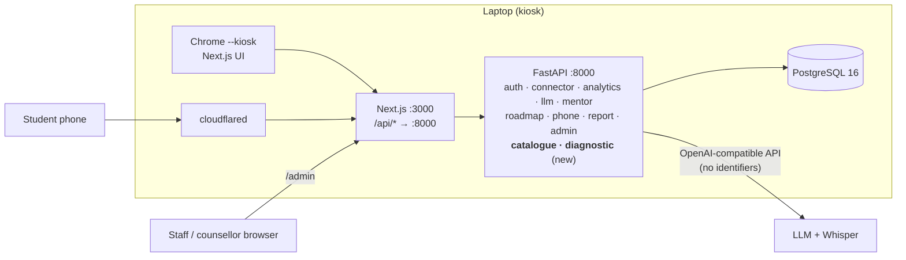
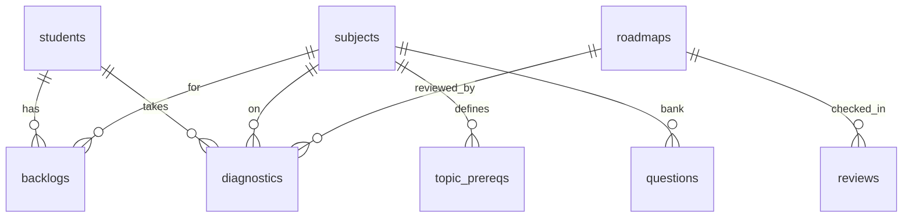
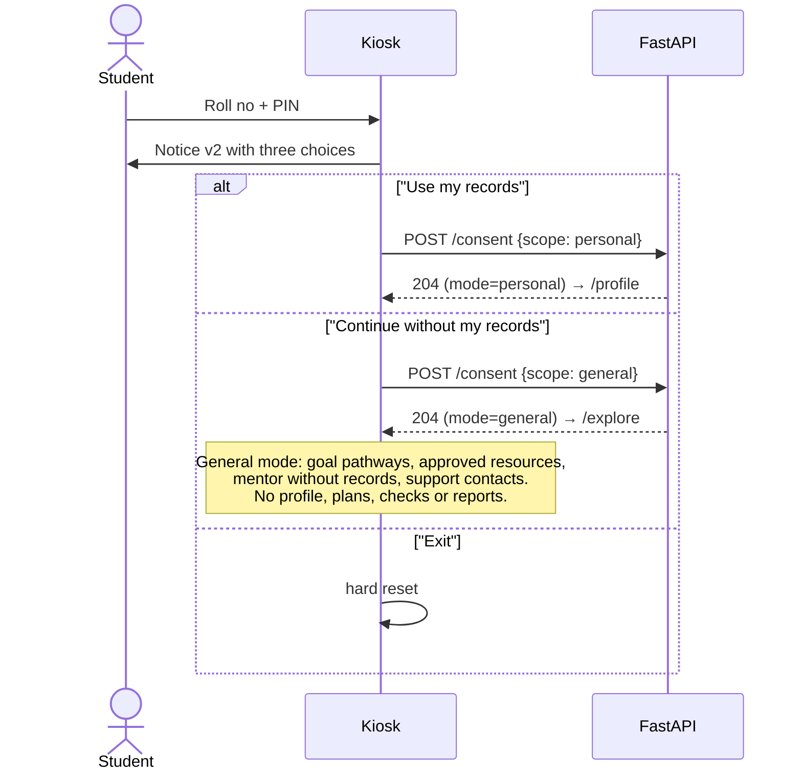
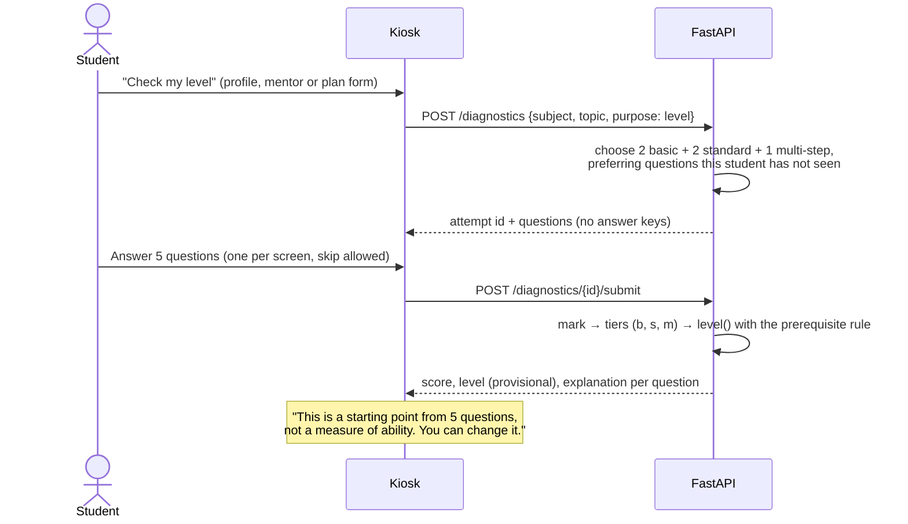
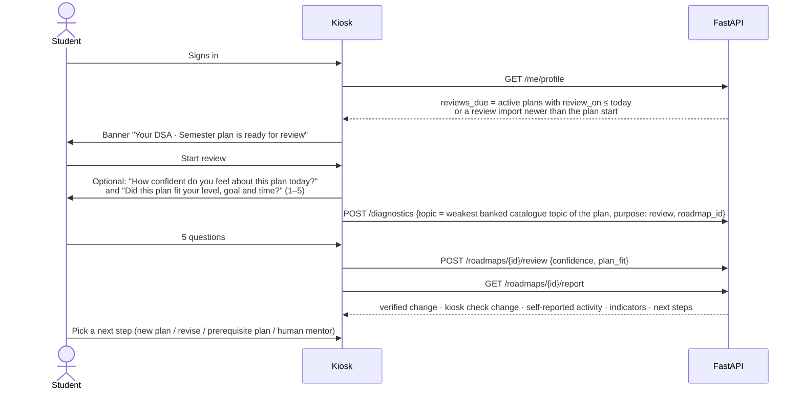

# AI Smart Student Mentor — High-Level Design, Next Release (v2)

| | |
|---|---|
| Project | AI Smart Student Mentor: Intelligent Academic Diagnosis, Personalized Learning & Career Guidance System (Trialshopy) |
| Document | High-Level Design for extending the built MVP to the revised project report |
| Version | 2.1 draft, 14 Nov 2026 (review pass: logic fixes, simplifications, RB §16 gaps) |
| Prepared by | _&lt;name&gt;_ |
| Requirement source | *AI Smart Student Mentor: Revised Project Concept & Implementation Report* (13 Nov 2026), cited below as **RB §n** |
| Baseline | The built system described in `docs/HLD.md` and `docs/LLD.md` (v1.1). Those documents stay unchanged and remain the reference for everything this document does not mention |
| Detailed design | `docs/LLD_next.md` |
| Scope | Same demo setup: a laptop is the kiosk, data is synthetic, the phone connects through the tunnel |

This is a **delta design**. Each section says only what changes. "Unchanged" means the v1 design applies as written.

---

## 1. Goals and scope

The core loop stays the same: **sign in → consent → diagnosis → conversation → roadmap → QR → review**. The revised report adds five main things:

1. **Goal-specific roadmaps:** semester improvement, backlog recovery, GATE, UPSC, placement / coding, and higher studies / research.
2. **A diagnostic step:** a short concept check gives a provisional learning level (foundation, beginner, intermediate or advanced) per topic.
3. **Level-aware resource matching:** resources are matched to the student's level, language and available time.
4. **A non-personalised general mode** for students who decline consent.
5. **A defined wellbeing path:** voluntary check-ins, support contacts and routed referrals. No inference about the student's state.

### 1.1 What is new (traceability to the revised report)

| # | Requirement | RB | Status in v1 | Delivered by (v2) |
|---|---|---|---|---|
| N1 | Each roadmap is tied to a goal, and each goal has its own components, resources and progress indicators. The student may hold plans for several goals | §4, §6, §13 P1 | Plans were per subject; goals only came up in chat | `GOALS` constant in `catalogue.py`, `roadmaps.goal`, goal-aware draft prompt, goal indicators in the report |
| N2 | Short diagnostic quiz / concept check when records are insufficient. Gives a provisional, revisable learning level | §4, §5.2, M5, §18, App. A | Not built | New `diagnostic` module, `questions` bank, `diagnostics` table, level rules in `analytics` |
| N3 | Level definitions (foundation, beginner, intermediate, advanced) based on demonstrated performance, never on institution | §5.2, §8, §17 | Not built | Pure `level()` rule. Its inputs are scores only. Institution is never imported |
| N4 | Resource metadata: level, language, duration, format, prerequisites, source, last-checked date. Matching by level, goal, language and time | §7, §12 | Only subject, topic, title, URL and kind | New `resources` columns, the `pick_resources()` filter, the `check-links` command |
| N5 | Link safety: approved domains and periodic broken-link checks | §7 | URLs checked once by hand | `APPROVED_DOMAINS` checked on import, `check-links` command, `link_ok` excluded from recommendations |
| N6 | A student who declines consent can still use a non-personalised general guidance mode | §4 | Decline reset the kiosk | Session `mode` = `general`; mentor without records; `/explore` page |
| N7 | Profile includes backlog status | §4, §5.1 | Not modelled | `backlogs` table + `BACKLOG` flag |
| N8 | New diagnostic signals: theory vs practical gap, prerequisite gap, targeted advanced-topic gap, insufficient evidence | §5.3 | Not modelled | `lab` assessment kind, `topic_prereqs` table, four new flags, each with a recommended response |
| N9 | Mentor asks about difficult topics, study habits, preferred format, goals, time and barriers, one question at a time | §4 | Partly done (format and barriers not asked) | Mentor prompt rules, plus preferences captured on the plan form |
| N10 | Voluntary, non-clinical check-in ("How confident do you feel about your study plan today?") | §8 | Not built | The mentor asks in chat (not stored); the review check-in asks again and stores the answer as self-reported |
| N11 | Support contacts shown when a student reports distress or asks for help. Private referral to a counsellor. Restricted support record | §8 | One generic referral; the screen only mentioned the counsellor desk | `seed/contacts.json`, a `support` flag on chat replies, request `category` → team routing, counsellor-only staff view |
| N12 | Review check-in at the review date: the kiosk prompts the student, imports new evidence and asks for a topic check | §4, §18 | Report was available, with no check-in | "Review due" banner, `/review/[id]` flow, `reviews` table |
| N13 | Report adds: goal, programme/semester, evidence counts, diagnostic change and mastery trend, next-step recommendation, referral status, limitations and data timestamps | §9, App. B | Partly done | Extended `Report` model and `next_steps()` rules |
| N14 | Roadmap adherence: completed, partial, pending and overdue, never treated as proof of learning | §9 | Done | Unchanged (kept as the self-reported block) |
| N15 | Correction, withdrawal and deletion processes | §15 | Plan deletion and correction requests | "Delete my kiosk data" also covers diagnostics, reviews and requests; consent records the scope |
| N16 | Staff dashboard: referral queue, aggregate insights, role-based access, small-group privacy, the §16 evaluation metrics | §10, M10, §16 | One staff role; §19 metrics of the old brief | `admin` and `counsellor` staff roles; new metrics (link health, human support, consent coverage, plan-fit rating, feedback comments) |
| N17 | AI outage: fallback to cached approved resources and the human-mentor option | §17 | Showed "AI is busy" plus the human mentor | Shows level-matched approved resources when drafting fails |
| N18 | The backend validates dates, workload, resource links and coverage before saving | §4 | Save skipped the review-date check | Save repeats the review-date check and checks combined daily workload across plans that are still running |
| N19 | Evaluation inputs: roadmap relevance rating and qualitative usefulness comments | §16 | Session rating only | Plan-fit rating (1–5) at the review check-in; optional anonymous comment with the end-of-session rating |

### 1.2 Unchanged from v1

PIN sign-in, kiosk sessions and idle reset, the QR hand-off, phone task status, the LLM gateway with provider fallback, speech, the print-to-PDF report, audit and retention mechanics, and the tunnel.

### 1.3 Out of scope for this release

| Item | Reason |
|---|---|
| SSO, OTP, ID-card scan, SIS/LMS/ERP APIs | RB §13 Phase 3; needs institutional approval. They stay behind `auth.py` and `connector.py` (v1 §16) |
| Face recognition, emotion inference, IQ estimates, mental-health labels | Prohibited by RB §8 |
| Mock-interview feedback, project review | Need a human evaluator (RB §6 placement indicators); represented only as plan checkpoints |
| A second student cohort or programme | Synthetic B.Tech CSE semester 3 is enough to demonstrate the design |
| Server-side PDF, pandas | RB §14 lists them as suggestions. Browser print and pure-Python rules already meet the need (v1 §2.2) |
| A controlled pilot evaluation | RB §13 Phase 4 |
| In-app faculty rating of plans and of diagnosis quality | RB §16 evaluates these through faculty review; it runs offline on printed reports and the admin aggregates, with no in-app workflow |

---

## 2. Architecture

### 2.1 Deployment view

Unchanged: one laptop runs Chrome in kiosk mode, Next.js, FastAPI, Postgres and cloudflared. The only architectural additions are two backend modules and one new data domain, the question bank.



Key decisions (new):

- **Diagnostics do not use the LLM.** Questions come from a reviewed bank and the server marks them. The concept check therefore works during an AI outage, cannot invent an answer key, and can be tested exactly. LLM-drafted questions are a later upgrade, and only through faculty review into the same bank (§16).
- **Three kinds of evidence, never mixed.** *Verified* = institutional records (`assessments`, `attendance`, `backlogs`). *Kiosk check* = diagnostic results (`diagnostics`). *Self-reported* = task ticks, confidence and preferences. Each one has its own tables, its own report section and its own source label. A diagnostic result never goes into `assessments`.
- **Goals are a constant.** The six RB §6 goals (components, indicators, allowed subjects) are one `GOALS` dict in `catalogue.py`. Goal codes are a type in the shared models and indicators are computed in code, so a table would add import work without making goals editable by non-developers.
- **A task's catalogue topic comes from its resource.** The AI writes `tasks.topic` as free text ("Binary trees"). Every task has an approved resource, and the resource's `topic` ("Trees") is the key used for levels, checks and the report.
- **One plan = one goal × one subject.** A multi-goal student holds several active plans. This reuses the v1 plan, report and QR machinery unchanged. The server caps their combined daily minutes.
- **Levels are rules, not model output.** `analytics.level()` maps check results (or records when there is no check) to a level and records its source. The LLM receives the level; it never decides it.
- **Support detection uses two independent paths.** A keyword match on the student's own message *or* a marker the model is told to emit shows the contacts panel. Either one is enough. Neither creates a record, labels the student or diagnoses anything.

### 2.2 Technology stack

Unchanged. No new dependencies. The link checker uses `httpx`, which ships with `fastapi[standard]`.

### 2.3 Backend modules

| Module | v1 responsibility | v2 change |
|---|---|---|
| `connector.py` | CSV import, record access | + `backlogs`, `prereqs`, `questions` CSVs; new resource columns; approved-domain check; abort on rejected rows; `check-links` CLI |
| `analytics.py` | Flags, upcoming, skill coverage, profile | + 5 flags (`BACKLOG`, `THEORY_PRACTICE_GAP`, `PREREQ_GAP`, `TARGETED_GAP`, `LOW_EVIDENCE`), recommended response per flag, `level()`, `topic_levels()`, levels and backlogs in the profile |
| **`catalogue.py`** (new) | | `GOALS` constant, read-only catalogue endpoints (goals with eligibility, approved resources, support contacts from `contacts.json`) and the `pick_resources()` matcher |
| **`diagnostic.py`** (new) | | Start a concept check (choose questions), submit and mark it, store topic evidence |
| `auth.py` | Sessions, consent, requests | + consent scope → session `mode`; `guided` dependency; request categories and routing; `DELETE /me/data`; staff roles |
| `mentor.py` | Grounded chat | + general-mode context, level, backlog and goal context, support detection, new rules (format, barriers, check-in, offer the concept check) |
| `roadmap.py` | Draft, validate, save, share | + goal, target date, levels and preferences; level/language/time-filtered resources; goal eligibility; review-date and workload checks on save; review check-in endpoint |
| `report.py` | Baseline vs review | + goal indicators, diagnostic change, `next_steps()`, referral status, limitations, data timestamps |
| `admin.py` | Aggregates, metrics, queue | + role-scoped queue (counsellor sees wellbeing only), new metrics, link health |
| `phone.py`, `llm.py`, `db.py`, `main.py` | | Small changes: goal label on the phone, an empty-choices guard, retention rules, router wiring |

---

## 3. Data model

### 3.1 Changes



| Table | Change | Purpose |
|---|---|---|
| `subjects` | + `kind` ∈ {course, track} | A **track** is non-assessed content a goal needs (Aptitude & Interview for placement, UPSC Foundation for UPSC). It has no marks, so its plans start from a check or a self-estimate |
| `assessments` | `kind` + `lab` | Practical assessments, for the theory-vs-practical rule (RB §5.3) |
| `backlogs` (new) | student, subject, semester, status (pending / cleared), batch | Backlog status (RB §4); drives the backlog-recovery goal |
| `topic_prereqs` (new) | (subject, topic) → (prereq subject, prereq topic) | Prerequisite gaps (RB §5.3) and resource prerequisites (RB §7) |
| `resources` | + `level`, `lang`, `minutes`, `goals[]`, `link_ok`, `checked_on` | RB §7 metadata. The source is derived from the URL host. The format is the existing `kind` |
| `questions` (new) | subject, topic, tier (basic / standard / multi), stem, 4 options, answer, explanation, `reviewed_by` | The reviewed concept-check bank (English; the interface around it stays bilingual) |
| `diagnostics` (new) | student, subject, topic, purpose (level / review), question ids, answers, per-tier result, level, seconds, started/submitted | Topic evidence from kiosk checks (RB §12 TopicEvidence) |
| `roadmaps` | + `goal` (a `GOALS` code), `target_date`, `levels` (jsonb) | RB §12 StudentGoal folded into the plan. Preferred format comes from the conversation, which the plan prompt already receives. Supersede and versioning are keyed by (student, goal, subject) |
| `reviews` (new) | roadmap, at, confidence, plan-fit rating | RB §12 ProgressReview (the student-side part; the comparison stays computed; the review check links to the plan through `diagnostics.roadmap_id`) |
| `sessions` | + `mode` ∈ {personal, general}; + `role` for staff | General mode; role-based staff access |
| `requests` | `kind` → `category` ∈ {academic, wellbeing, correction}; + `closed_at` | RB §12 SupportRequest: category, status, response time. The assigned team is derived from the category by a routing table |
| `feedback` | + optional `comment` (≤ 300 chars, still anonymous) | RB §16 qualitative usefulness comments |
| (file) `seed/contacts.json` | team, name, how to reach, hours | Institution-approved contacts (RB §8); a file, not a table |

**Still not stored:** chat transcripts, audio, camera data, prompts or replies, institution or college name, any wellbeing note the student did not choose to share.

### 3.2 Mapping to the report's suggested entities (RB §12)

| RB entity | v2 table(s) |
|---|---|
| Student | `students` (institution deliberately absent) |
| Consent | `sessions.mode` + `consented_at` + `audit_log` (`consent`, target = notice version and scope); withdrawal = `DELETE /me/data` + `data_delete` audit |
| AcademicRecord | `assessments`, `attendance`, `backlogs` (+ `imports` for the verification source and time) |
| TopicEvidence | `diagnostics` |
| StudentGoal | `roadmaps.goal`, `target_date`, `daily_minutes` (preferences live in the conversation) |
| Resource | `resources` |
| Roadmap / RoadmapTask | `roadmaps`, `tasks` (unchanged shape) |
| ProgressReview | `reviews` + the computed `Report` |
| SupportRequest | `requests` |
| AuditLog | `audit_log` |

### 3.3 Schema migration

`schema.sql` is edited in place. A demo database is recreated once (`docker compose down -v`, then re-import). `ponytail: in-place schema plus a reset, fine for synthetic data; Alembic before any real data` (v1 §16 already lists that upgrade).

---

## 4. API

New and changed routes only. Everything else is as in v1 §4.

| Method | Path | Purpose | Auth |
|---|---|---|---|
| POST | `/consent` | **Changed:** `{notice_version, scope: personal | general}` sets the session mode | kiosk |
| GET | `/me/profile` | **Changed:** + backlogs, new flags with recommended responses, topic levels, `reviews_due` | kiosk + personal |
| DELETE | `/me/data` | **Replaces** `/me/plans`: plans, diagnostics, reviews and the student's closed requests | kiosk + personal |
| POST | `/requests` | **Changed:** `{category, subject_code?, note?, share_note}`; returns the team and that team's contacts | kiosk (either mode) |
| POST | `/mentor/chat` | **Changed:** works in both modes; reply includes `support: bool` | kiosk (either mode) |
| GET | `/goals` | Goal catalogue with the subjects this student may plan for each goal | kiosk (either mode) |
| GET | `/resources` | Approved, link-checked resources, filtered by subject, topic, level, language, max minutes | kiosk (either mode) |
| GET | `/support/contacts` | Institution-approved support contacts | none (public information) |
| POST | `/diagnostics` | Start a concept check: `{subject_code, topic, purpose, roadmap_id?}` → 5 questions, no answers | kiosk + personal |
| POST | `/diagnostics/{id}/submit` | Answers → marked result, per-question explanations, provisional level | kiosk + personal (owner) |
| POST | `/stt` | **Changed:** allowed in both modes (voice works in general mode too) | kiosk (either mode) |
| POST | `/roadmaps/draft` | **Changed:** + `goal`, `target_date?`, `level_overrides` | kiosk + personal |
| POST | `/roadmaps` | **Changed:** + goal fields; review-date and workload checks | kiosk + personal |
| POST | `/roadmaps/{id}/review` | Review check-in: `{confidence?, plan_fit?}` | kiosk + personal (owner) |
| POST | `/feedback` | **Changed:** + optional `comment` | kiosk |
| GET | `/roadmaps/{id}/report` | **Changed:** extended `Report` | kiosk (owner) |
| POST | `/admin/login` | **Changed:** the password that matches decides the role (`admin` or `counsellor`) | none |
| GET | `/admin/summary` | **Changed:** role-scoped | staff |

"kiosk + personal" is the v1 `consented` dependency, now meaning `mode = personal`. "Either mode" is the new `guided` dependency: consent was given in either scope.

---

## 5. Key flows

### 5.1 Consent with the general-mode alternative (RB §4)



General mode still sends chat text to the external AI. The notice says so for both scopes. Record-based routes return `403 consent_required` in general mode, the same way unconsented sessions are refused in v1.

### 5.2 Concept check and level (RB §4, §5.2)



Level sources, in priority order: the student's own override on the plan form (source `student`), the latest check for that topic (`check`), the records estimate (`records`), otherwise `unknown`, in which case the kiosk offers a check. The plan stores each level together with its source.

### 5.3 Goal-specific roadmap (RB §4, §6, §7)

```mermaid
sequenceDiagram
    actor S as Student
    participant K as Kiosk
    participant A as FastAPI
    participant L as LLM
    K->>A: GET /goals → eligible subjects per goal
    S->>K: Goal, subject, days, minutes/day, review date,<br/>target date (exam goals), levels (adjustable)
    K->>A: POST /roadmaps/draft
    A->>A: levels = topic_levels() + overrides<br/>allowed = pick_resources(subject, goal, levels, lang, minutes)
    A->>L: prompt: GOAL components + EVIDENCE + LEVELS + RECOMMENDED RESPONSES + resources
    A->>A: validate (v1 checks; allowed ids already level/lang/time filtered)
    A-->>K: draft
    alt AI unavailable
        A-->>K: 502 ai_unavailable
        K->>A: GET /resources?subject&level&lang&max_minutes
        K->>S: "AI is busy: here are approved resources at your level" + human mentor
    end
    S->>K: Edit / remove / regenerate → Save
    K->>A: POST /roadmaps (re-check resources, ranges, review date, combined daily minutes)
```

### 5.4 Review check-in (RB §4, §9, §18)



### 5.5 Support and wellbeing (RB §8)

```mermaid
sequenceDiagram
    actor S as Student
    participant K as Kiosk
    participant A as FastAPI
    participant L as LLM
    S->>K: "I'm really stressed and can't cope"
    K->>A: POST /mentor/chat
    A->>A: keyword match on the student's last message
    A->>L: chat (system rule: start with [[SUPPORT]] when the student reports distress or asks for help)
    L-->>A: "[[SUPPORT]] I'm sorry it feels heavy..."
    A-->>K: {reply (marker stripped), support: true}
    K->>S: Kind reply + support panel: approved contacts, urgent line,<br/>"Request a private counsellor referral"
    S->>K: Request referral (note optional, shared only if ticked)
    K->>A: POST /requests {category: wellbeing, share_note}
    A->>A: team = counsellor (routing table); visible only to the counsellor role
```

Nothing in this path is stored unless the student asks for a referral. A referral record holds the category, team, status and, only when the student ticks "share", the note. No label, score or mood is ever stored.

---

## 6. Academic analytics

### 6.1 New flags (RB §5.3)

Each flag keeps the v1 shape `{code, subject, topic?, values (incl. n), reason}`. Each code also has a fixed **recommended response** (RB §5.3, third column), shown under the reason and passed to the plan prompt.

| Flag | Rule (default threshold) | Example reason | Recommended response |
|---|---|---|---|
| `LOW_VS_SELF`, `LOW_VS_CLASS`, `DECLINING`, `WEAK_TOPIC` | Unchanged | Unchanged | "Start with prerequisite explanation, worked examples and practice" |
| `LOW_ATTENDANCE` | Unchanged | Unchanged | "Here is the attendance figure. A mentor can help if something is getting in the way" |
| `MISSING` | Unchanged | Unchanged | "Check the record with the department; ask for a correction if it is wrong" |
| `BACKLOG` (new) | Pending backlog in the subject | "Backlog from semester 2 not yet cleared" | "Backlog recovery plan: syllabus breakdown, prerequisite repair, exam-oriented revision" |
| `THEORY_PRACTICE_GAP` (new) | ≥ 2 scored labs; theory % (quiz + internal) − lab % ≥ 15 | "Theory 74% vs lab work 52% (3 labs)" | "Add coding labs, guided exercises and debugging tasks" |
| `PREREQ_GAP` (new) | Topic % < 50 (n ≥ 2) and a prerequisite topic % < 60 | "Graphs 40%; its prerequisite Trees is also low at 55%" | "Repair the prerequisite first, then return to the topic" |
| `TARGETED_GAP` (new) | Topic % < 50 (n ≥ 2), every prerequisite ≥ 70 | "Graph Theory 45% while its prerequisites average 78%" | "Target this topic instead of repeating the whole subject" |
| `LOW_EVIDENCE` (new) | Subject has < 3 scored assessments | "Only 2 assessments recorded for Computer Networks" | "Evidence is limited: answer a few questions and take a short concept check before drawing conclusions" |

`PREREQ_GAP` and `TARGETED_GAP` run for every subject, not only flagged ones, because RB §5.3 describes them at topic level. All thresholds stay in the faculty-tunable `RULES` dict.

### 6.2 Learning level (RB §5.2)

Levels are per topic, provisional, and carry their source. The **inputs are scores only**. The function signature has no parameter that could carry an institution, gender, region or name, and a test enforces this.

| Source | Rule |
|---|---|
| Concept check (5 items: b = basic correct 0–2, s = standard 0–2, m = multi-step 0–1) | Evaluated in order: total ≤ 1 → **foundation**; b = 2, s = 2, m = 1 → **advanced**; b ≥ 1, s ≥ 1, total ≥ 3 → **intermediate**; otherwise → **beginner**. The check measures only the topic it asks about; a prerequisite gap changes the plan order (the `PREREQ_GAP` response), not the check's level |
| Records only (topic %, n ≥ 2) | % < 40 or a `PREREQ_GAP` on the topic (same records, so never stale) → foundation; < 60 → beginner; < 80 → intermediate; otherwise advanced |
| Records with n < 2 and no check | `unknown` → the kiosk offers a check |
| Student override | Any level, source `student`, audited `level_override` |

The newest check for a topic beats the records estimate. Every displayed level says "provisional" and states its source ("from your 5-question check on 14 Nov"). Each topic also carries `has_check`: the bank covers DSA and DM in this release, and the Check button is hidden elsewhere.

### 6.3 Profile additions

Backlogs, topic levels for flagged subjects, recommended responses, and `reviews_due`. Skill coverage, data timestamps and upcoming assessments are unchanged.

---

## 7. AI design

### 7.1 Mentor prompt changes

- **Context (personal mode)** adds backlogs, topic levels with their source, the new flags with their recommended responses, and the goal catalogue names. Still no name, roll number or institution.
- **Context (general mode)** contains the programme-agnostic goal catalogue (components and indicators), approved resource *titles* for the requested area, and how the kiosk works. It has **no records**, and the model is told it has none.
- **New rules:**
  - Ask about preferred format and barriers.
  - Once the plan is agreed, ask the voluntary confidence question once.
  - When evidence is limited or a level is unknown, offer the concept check ("tap Check my level").
  - Describe levels as provisional starting points, never as ability or intelligence.
  - When the student reports distress or asks for help, begin the reply with `[[SUPPORT]]`, reply kindly in one or two sentences, and do not counsel.
- **Support detection:** `support = marker_present OR keyword_hit(last user message)`. The keyword list covers English and Hindi (Devanagari and romanised). The marker is always stripped from the reply before it is returned or spoken.

### 7.2 Roadmap prompt changes

```
GOAL: GATE preparation: Subject-wise foundation, standard problems, previous-year questions and mock tests.
PROGRESS INDICATORS: accuracy, time per question, mock-test trend.
TARGET DATE: 2027-02-01 (exam).
SUBJECT: Data Structures (DSA)
EVIDENCE: <flags with reasons and n>
RECOMMENDED RESPONSES: PREREQ_GAP → repair the prerequisite first ...
LEVELS (provisional): Graphs foundation (records); Trees beginner (check, 14 Nov)
APPROVED RESOURCES (use only these ids; level, language, minutes shown):
  [12] Graphs — "BFS and DFS" (practice, beginner, en, 30 min) ...
Rules (added to v1):
- Start each topic at its level and move up one level at most per stage (foundation → beginner → intermediate).
- Follow RECOMMENDED RESPONSES: prerequisite repair before the topic; labs and debugging for a theory–practice gap.
- Match the goal's components; for exam goals include previous-year questions or timed practice before the target date.
- Prefer formats the student asked for in CONVERSATION when an approved resource of that format exists.
```

The output contract is unchanged (v1 §7.3). The resource list is already filtered by level (one level below to two above the student's, so a foundation topic can progress to intermediate), language (the student's language, then English), time (`minutes ≤ daily_minutes`, or `kind = course`, which is multi-session), goal tag and `link_ok`, so the existing "resource must be in the allowed list" check enforces level, language and time matching. No extra validator is needed. If filtering leaves a topic with no resources, that topic falls back to all of its approved resources, so a plan is never blocked.

### 7.3 Guardrails (additions)

- Levels, flags, indicators and next steps come from rules. The LLM only phrases.
- Concept-check questions and answer keys come only from the reviewed bank.
- The LLM receives no institution data, because none exists in the system.
- When the AI is down, the student still gets level-matched approved resources, the concept check and the human mentor (RB §17).

---

## 8. Frontend

| Route | Change |
|---|---|
| `/consent` | Notice v2 with three buttons: Use my records / Continue without my records / Exit |
| `/explore` (new) | General mode: goal pathways (components, indicators), approved resources by subject, level and language; "Talk to the mentor" (general); support contacts |
| `/profile` | + backlogs, recommended response under each flag, topic levels with "Check my level", review-due banner, plans grouped by goal, "Delete my kiosk data" |
| `/mentor` | Works in both modes; "Create my plan" and "Check my level" only in personal mode; support panel when `support` is true; sends only the last 16 messages |
| `/check` (new) | Choose subject and topic (defaults to the weakest flagged topic) → 5 questions, one per screen, large buttons, skip allowed → result with level, source, per-question explanation, "provisional" note → back to the caller |
| `/roadmap/new` | Goal first, then subjects eligible for that goal; target date for exam goals; levels per weak topic (adjustable); AI-busy fallback list |
| `/review/[id]` (new) | Check-in: confidence and plan-fit rating (both optional) → concept check → report → choose a next step |
| `/end` | + optional anonymous comment with the 1–5 rating |
| `/report/[id]`, `/m` | Goal, programme/semester, kiosk-check block, indicators, next steps, referral status, limitations, data timestamps |
| Header "Talk to a human" | Choose **Academic mentor** or **Counsellor (private)**; contacts shown immediately; optional note with a "share this note" tick |
| `/admin` | Admin role: aggregates, metrics (incl. plan-fit ratings and feedback comments), academic and correction queue, wellbeing *counts only*, link health. Counsellor role: wellbeing queue only |

Kiosk behaviour (idle reset, back-forward cache guard, health overlay, captions, large targets) is unchanged and applies to the new pages.

---

## 9. Security, privacy and responsible AI (RB §8, §15)

| Requirement | v2 implementation |
|---|---|
| Consent, with a real alternative | Notice v2 names: records used (now including backlogs and lab marks), kiosk checks stored, goals and preferences stored with plans, AI processing in both modes, wellbeing request handling, retention. Scope recorded in the session and in the audit |
| No face, emotion, IQ or mental-health inference | No camera anywhere (unchanged). Levels are per-topic readiness from scores and are labelled provisional. Confidence is stored only as the student's own answer and is never interpreted |
| Wellbeing data minimisation | Contacts are shown without creating any student-linked record (the audit counts the event as `system`, with no student id). A referral stores category, team and status, plus a note only when the student ticks share. Wellbeing requests are visible only to the counsellor role, and their audit rows use actor `system` so they never show in the admin audit view. Admin sees counts. Closed wellbeing requests are deleted after 90 days |
| No institution proxy | Not imported (absent from `PERMITTED` and the CSV contract; extra columns are ignored). `level()` and the prompts cannot receive it. A test asserts this. The cohort has no group attributes to compare across; when a second programme exists, level distribution per programme (groups ≥ 5) becomes the RB §17 audit |
| Role-based staff access | Two staff passwords, two roles. Each route checks the role |
| Correction, withdrawal, deletion | Correction requests (unchanged). "Delete my kiosk data" removes plans, checks, reviews and the student's closed requests. Open requests stay until staff close them, so a pending referral is not lost by accident |
| Link safety | Approved-domain list enforced on import; `check-links` marks broken links, which are then excluded from recommendations |
| QR tokens (RB §14 "signed tokens") | Random 256-bit single-use tokens stored only as SHA-256 hashes (v1). Equivalent to a signed token for this use, and revocable server-side, which a signed token is not |
| Separation of evidence | Report sections and models keep verified, kiosk-check and self-reported sources apart (§2.1). Tests check the invariant |

Retention additions: unsubmitted checks are deleted after 1 day. Checks and reviews live with the student's plans (deleted with them or at semester end). Closed wellbeing requests are deleted after 90 days and other closed requests after 180.

---

## 10. Non-functional requirements (additions)

| Area | Target |
|---|---|
| Concept check start / submit | < 300 ms (no external calls) |
| Concept check length | 5 questions, about 3 minutes |
| AI outage | Check, resources, report and human mentor all keep working |
| Link check | All approved resources checked in < 2 min (concurrent HEAD/GET, 10 s timeout) |
| Accessibility | Each question is keyboard-operable (1–4 keys plus Enter), large text mode; question text is English, the surrounding interface follows the chosen language |

---

## 11. Testing (additions)

| Area | Check |
|---|---|
| Analytics | Each new flag fires at its threshold and not just past it; `PREREQ_GAP` vs `TARGETED_GAP` are mutually exclusive for a topic; recommended response present for every code |
| Levels | Truth table for `level()` over all 18 (b, s, m) combinations; records estimate bands; source priority; the signatures have no non-score inputs |
| Topic mapping | Levels, checks and report use the task's resource topic, never the free-text task topic |
| Diagnostics | No answer key in the start response; unseen-first selection; marking; owner-only submit; double submit → 409; expired attempt → 410; works with the LLM patched to fail |
| Resource matching | Level window (−1…+2), language fallback, time filter, `link_ok` exclusion, never-empty fallback |
| Goals | Eligibility (backlog goal only with a pending backlog; tracks plannable without records); supersede per (goal, subject); combined daily-minutes cap |
| Report | Kiosk-check change never alters verified figures; indicators carry their source; `next_steps()` table; limitations listed when evidence is thin |
| Privacy | General mode cannot reach profile, plans or checks; counsellor-only wellbeing queue; note stored only when shared; delete-my-data scope |
| Support | Keyword or marker → `support: true`; marker stripped from the reply |
| Bank integrity | Every DSA and DM topic has ≥ 2 basic, ≥ 2 standard, ≥ 1 multi; 4 options; answer in 0–3; unique stems |
| E2E | v1 journey plus: check Graphs → GATE plan → review check-in → report with next steps, run twice |

---

## 12. Synthetic data (additions)

- **Dates are relative to the day `gen.py` runs.** This fixes the v1 time bomb, where the upcoming internal was hard-coded to 24 Nov. Reset regenerates and re-imports. Tests generate into a temporary folder.
- `lab` assessments for DSA, DBMS, OS and CN (2 baseline + 1 review each).
- Designed cases:

  | Student | Case |
  |---|---|
  | `CS23001` (demo) | Unchanged marks. Now also yields `PREREQ_GAP` on Graphs (Trees 55% < 60), so Graphs starts at foundation from records, matching the RB §18 "foundation-to-intermediate" path |
  | `CS23004` | DBMS theory ≈ 75%, labs ≈ 50% → `THEORY_PRACTICE_GAP` |
  | `CS23005` | Pending DM backlog from semester 2 → `BACKLOG` and the backlog-recovery goal |
  | `CS23006` | CN has only 2 scored assessments → `LOW_EVIDENCE` |
  | `CS23007` | DM Graph Theory weak with strong prerequisites → `TARGETED_GAP` |

- Prerequisite map: about 15 edges. Examples: DSA Trees ← Linked Lists; DSA Graphs ← Trees and DM Graph Theory; DBMS Normalization ← ER Model; OS Synchronization ← Processes.
- Goals: the six RB §6 goals. Tracks: `APT` (Aptitude & Interview) and `UPSC` (UPSC Foundation), five topics each.
- Resources: the existing 50 get level, language and minutes tags, plus about 30 new ones: level ladders for demo topics, a few Hindi-language resources, GATE previous-year question / mock sources, and track resources. Every URL must be on the approved domain list and return 200 before commit (v1 rule).
- Question bank, DSA and DM only (about 60 items): ≥ 5 items (2 / 2 / 1) per topic, and ≥ 10 (4 / 4 / 2) for the demo topics DSA Trees, DSA Graphs and DM Graph Theory, so the review check uses unseen questions. Other subjects use the records estimate until their bank is written. Each item records `reviewed_by`. **Faculty review is required before any real use.**
- Support contacts (`seed/contacts.json`): institution placeholders plus one national helpline, verified before the demo.

---

## 13. Running the demo (changes)

```bash
./scripts/reset.sh            # new: docker volume reset, gen.py (dates from today), import baseline
./scripts/dev.sh              # unchanged
cd api && uv run python -m app.connector check-links    # before the demo; marks broken links
# at "review time":
cd api && uv run python -m app.connector import seed --batch review
```

Demo script additions:

1. `CS23001` sees `PREREQ_GAP` and Graphs at foundation (records).
2. They take the Graphs check and see their level.
3. They make a GATE plan for DSA with a target date.
4. QR to the phone, tick tasks.
5. Import the review batch; the review banner appears.
6. Check-in with confidence, then the Graphs check again.
7. The report shows the verified change, the kiosk-check change, self-reported activity, indicators and next steps.
8. Decline consent with `CS23002` to show general mode.
9. Type a distress message to show the support panel and the counsellor referral; open `/admin` as the counsellor.

---

## 14. Risks (additions)

| Risk | Mitigation |
|---|---|
| A wrong answer key in the bank mis-levels a student | Faculty-reviewed bank with `reviewed_by`; levels labelled provisional; student override; explanation shown for every question |
| Guessing on 4-option questions inflates a level | Multi-step item needed for advanced; level is provisional; records estimate shown alongside |
| Over-triggering the support panel | Showing contacts is harmless, and nothing is stored without a request. Under-triggering is the worse failure, which is why there are two independent paths |
| Goal content outside the CSE catalogue (UPSC) is thin | Tracks with curated resources and a self-estimated level; limitations noted in the report |
| Several active plans overload the student | Combined daily-minutes cap on save; profile shows the total |
| More resources mean more link rot | `check-links` before the demo and periodically; broken links excluded automatically |
| Schema change on an existing demo DB | One-time reset script; synthetic data only |

---

## 15. Build plan

Same procedure as v1: contracts first, then parallel components, then integration. The dates are left to the presenter. Sizes assume agent-driven building.

| Phase | Work | Parallel? | Gate |
|---|---|---|---|
| 0, fixes | v1 review findings: client sends the last 16 messages; seed dates relative to today; save checks the review date; import aborts on rejected rows; `llm` empty-choices guard; TTS waits for `voiceschanged`; `.env` inline-comment parsing | Yes | v1 suite green |
| 1, contract | `schema.sql` v2, `schemas.py` ↔ `types.ts`, stub routers for `catalogue` and `diagnostic`, CSV contracts, conftest updates, reset script | No | App boots, `/docs` lists every new route, suite still green |
| 2, components | Connector + seed + question bank + resources (and link check) · analytics flags + levels · catalogue · diagnostic · auth (modes, requests, roles) | Yes | Each component's tests pass |
| 3, features | Mentor changes · roadmap goal/levels/workload/review · report extensions · web: consent, explore, check, plan form, review, support panel | Yes | Journey to plan works; general mode works |
| 4, staff + E2E | Admin roles and metrics · E2E for the new journey (twice) · doc pass | Yes | Full demo script passes twice in a row |

---

## 16. Upgrade paths (additions)

| v2 choice | Later replacement | Confined to |
|---|---|---|
| Hand-written, faculty-reviewed question bank | LLM-drafted items, faculty-approved into the same bank; adaptive (IRT-style) selection | `seed/questions.csv`, `diagnostic.py` |
| One goal × one subject per plan | Multi-subject goal plans (e.g. a full GATE schedule) | `roadmap.py`, `report.py` |
| Keyword + marker support detection | Institution-approved classifier, reviewed by counsellors | `mentor.py` |
| Two staff passwords | SSO groups → roles | `auth.py` |
| Contacts in a JSON file | Institutional directory API | `catalogue.py` |
| Goals as a constant | A table, once faculty need to edit goals without a deploy | `catalogue.py` |
| Question bank for DSA and DM | Every course subject | `seed/questions.csv` |
| Rule-based next steps | Faculty-tuned rules per programme | `report.py` |

---

## 17. Requirement traceability (revised report → design)

| RB | Requirement | Where |
|---|---|---|
| §1–3 | Evidence-based profile, explainable gaps, goals, levels, resources, review, human routing | §1.1 N1–N18 |
| §4 | Journey: identification, consent + general mode, retrieval, analysis, conversation, level check, roadmap, approval, QR, follow-up, human support | §5.1–5.5, v1 §5 |
| §5.1 | Evidence types kept separate | §2.1 three evidence kinds, §3 |
| §5.2 | Level definitions; no institution proxy | §6.2, §9 |
| §5.3 | Diagnostic rules with responses | §6.1 |
| §6 | Goal roadmaps and indicators | `GOALS` (§2.1), §5.3, §7.2, LLD C9 indicators |
| §7 | Resource catalogue, level, time, link safety | §3 `resources`, §7.2 filter, `check-links` |
| §8 | No face/emotion/IQ; voluntary check-ins; contacts; restricted referral | §5.5, §9 |
| §9, App. B | Report contents and limitations | §5.4, LLD C9 |
| §10–11 | Architecture and modules M1–M10 | §2, v1 §2 |
| §12 | Data model | §3.2 |
| §13 | Phases 1–2 delivered; 3–4 out of scope | §1.3 |
| §14 | Stack | Unchanged (v1 §2.2); pandas and server PDF intentionally not adopted; hashed random QR tokens instead of signed ones (§9) |
| §15 | Security and governance | §9, v1 §9 |
| §16 | Evaluation metrics | LLD C10 metrics, N19 plan-fit rating and comments; faculty reviews offline (§1.3) |
| §17 | Risks | §14, v1 §14 |
| §18, App. A | Scenario | §13 demo script |
