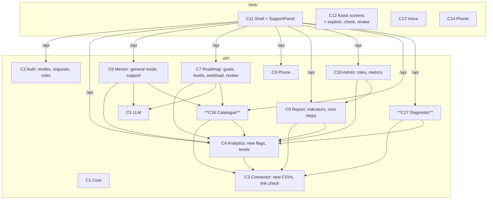
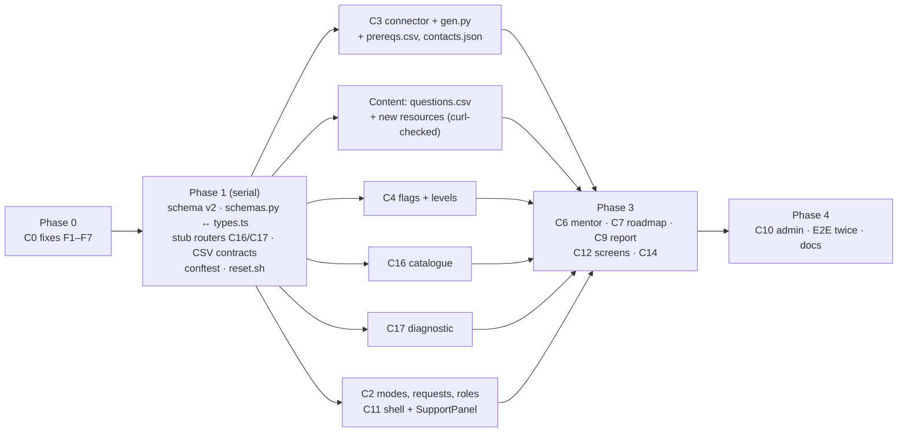

# AI Smart Student Mentor — Component Technical Design, Next Release (LLD v2)

| | |
|---|---|
| Version | 2.1 draft, 14 Nov 2026 (review pass: logic fixes, simplifications, RB §16 gaps) |
| Companion | `docs/HLD_next.md` (what and why). The v1 contracts remain in `docs/LLD.md` |
| Requirement source | Revised Project Concept & Implementation Report (13 Nov 2026), cited as **RB §n** |

This is the build contract for v2. It is a **delta over LLD v1**. Each component lists what it now owns, the exact interface changes, data, rules, errors, tests and a definition of done (DoD). Anything not mentioned keeps its v1 contract. Components still talk to each other only through the interfaces written here, so they can be built in parallel.

---

## 0. Conventions

All v1 conventions (§0 of LLD v1) still apply: sync endpoints, hand-written SQL, commit before returning, module-qualified calls, no token or prompt logging, `no-store`. Additions:

| Topic | Decision |
|---|---|
| Evidence separation | Three sources, never mixed in one field: **verified** (`assessments`, `attendance`, `backlogs`), **kiosk_check** (`diagnostics`), **self_reported** (`tasks.status`, `reviews.confidence`, `reviews.plan_fit`). Every derived value that reaches the UI carries its source |
| Levels | `Level = foundation | beginner | intermediate | advanced`, always with `source ∈ {check, records, student}` and labelled *provisional* in the UI |
| Session modes | `personal` (records consent) and `general` (no records). Dependencies: `consented` = personal only (v1 name kept); `guided` = either mode |
| Catalogue data | Prerequisites and questions are CSV-imported curriculum data. Contacts are `seed/contacts.json`. Goals are the `GOALS` constant (C16.2): their codes are a type and their indicators are code, so a table would add nothing |
| Topic keys | A task's **catalogue topic** is `resources.topic` of its `resource_id`. `tasks.topic` is free text written by the AI and is used for display only. Levels, checks, overrides and the report always use catalogue topics |
| Randomness | Question selection uses `random.Random()` seeded from `secrets.randbits(32)`; tests assert properties, not exact picks |
| No new dependencies | `httpx` (already installed with `fastapi[standard]`) is the only extra import, used by the link checker |

### 0.1 New error codes

| Status | `detail` | Meaning | Frontend action |
|---|---|---|---|
| 403 | `consent_required` | **Extended:** also returned to a general-mode session on a personal-only route | General mode → `/explore` |
| 403 | `forbidden_role` | Staff role may not see or close this item | Show "not available for your role" |
| 409 | `already_submitted` | Concept check already submitted | Show the stored result |
| 410 | `check_expired` | Concept check older than 30 min | "Start the check again" |
| 422 | `review_too_soon` | **Now also on save:** `review_on < start + days` | Field error on review date |
| 422 | `over_daily_capacity` | Active plans would exceed 240 min/day combined | Show current total, ask to reduce minutes |
| 422 | `not_enough_questions` | Bank lacks items for the requested topic (should be prevented by the bank-integrity test) | Hide the check; offer self-estimate |

### 0.2 Repository layout: new and changed files

```
api/
  schema.sql                                        C1   (changed)
  app/config.py  app/db.py  app/main.py  app/schemas.py   C1   (changed)
  app/auth.py                                       C2   (changed)
  app/connector.py  seed/gen.py                     C3   (changed)
  seed/{subjects,resources}.csv                     C3   (new columns)
  seed/{backlogs,prereqs,questions}.csv  seed/contacts.json   C3 (new)
  app/analytics.py                                  C4   (changed)
  app/llm.py                                        C5   (one guard)
  app/mentor.py                                     C6   (changed)
  app/roadmap.py                                    C7   (changed)
  app/phone.py                                      C8   (goal label)
  app/report.py                                     C9   (changed)
  app/admin.py                                      C10  (changed)
  app/catalogue.py                                  C16  (new)
  app/diagnostic.py                                 C17  (new)
  tests/test_catalogue.py  tests/test_diagnostic.py  tests/test_levels.py  tests/test_bank.py  (new)
web/
  lib/{types,i18n,voice}.ts  app/providers.tsx  components/KioskShell.tsx   C11  (changed)
  components/SupportPanel.tsx                       C11  (new)
  app/(kiosk)/{consent,profile,mentor,roadmap/new,report/[id]}/   C12  (changed)
  app/(kiosk)/{explore,check,review/[id]}/          C12  (new)
  components/ConceptCheck.tsx  components/ReportView.tsx   C12  (new / changed)
  app/m/                                            C14  (changed)
  app/admin/                                        C10  (changed)
scripts/reset.sh                                    C15  (new)
docs/HLD_next.md  docs/LLD_next.md
```

### 0.3 Component map (v2 additions bold)



---

## C0 — Fixes carried over from the v1 review (do first)

These come from the review of the built repo. They touch the same files as v2, so they land first, and each fix comes with a regression test.

| # | File | Fix | Test |
|---|---|---|---|
| F1 | `web/app/(kiosk)/mentor/page.tsx`, `roadmap/new/page.tsx` | Send `messages.slice(-16)` (the server only uses 16; it rejects > 40 with 422) | Manual: a 25-turn chat still replies; API test: 40 messages accepted |
| F2 | `seed/gen.py`, `tests/test_roadmap.py` | All dates relative to `ANCHOR = date.today()` (see C3.5); the test computes the expected upcoming date instead of the literal `2026-11-24` | The test reads the upcoming date from the generated CSV; no literal dates remain in tests (`grep -rn '2026-' tests/` is empty) |
| F3 | `roadmap.py` save | Repeat `review_on ≥ today + days` → 422 `review_too_soon` | Save with a past `review_on` → 422 |
| F4 | `connector.import_csv` | Any rejected row → `conn.rollback()`, nothing written, `imports` row with the errors in a separate transaction, exit 1 | CSV with 3 bad rows → 3 errors **and** batch unchanged |
| F5 | `llm.chat` | `if not r.choices: raise ValueError("no choices")` before indexing (falls through to the next provider) | Fake client returning `choices=[]` → next provider |
| F6 | `web/lib/voice.ts` | `speak()` awaits voices: if `getVoices()` is empty, wait for `voiceschanged` (max 1 s), then pick | Manual: first Hindi reply is spoken |
| F7 | `connector._load_env_file` | Strip an inline ` #` comment for every key, same as bash | Unit test on a sample `.env` |

---

## C1 — Core platform (changes)

### C1.1 `config.py`

```python
COUNSELLOR_PASSWORD: str    # optional; "" disables the counsellor role; if set, ≥ 12 chars and != ADMIN_PASSWORD
APPROVED_DOMAINS: tuple[str, ...]   # constant, below
MAX_DAILY_MINUTES = 240     # combined across a student's active plans
```

`APPROVED_DOMAINS`: `geeksforgeeks.org, visualgo.net, nptel.ac.in, ocw.mit.edu, cp-algorithms.com, khanacademy.org, youtube.com, gateoverflow.in, ncert.nic.in, pib.gov.in, prsindia.org, upsc.gov.in, indiabix.com`. A host matches if it equals a domain or ends with `"." + domain`.

### C1.2 `schema.sql` (v2; edited in place, demo DB reset once)

Only changed or new tables are shown. Order matters for foreign keys: `roadmaps` before `diagnostics`.

```sql
CREATE TABLE IF NOT EXISTS subjects (
  id serial PRIMARY KEY,
  code text UNIQUE NOT NULL,
  name text NOT NULL,
  kind text NOT NULL DEFAULT 'course' CHECK (kind IN ('course','track'))   -- track: non-assessed goal content
);
-- assessments: kind CHECK becomes ('quiz','internal','assignment','lab'); nothing else changes

CREATE TABLE IF NOT EXISTS backlogs (
  student_id int NOT NULL REFERENCES students ON DELETE CASCADE,
  subject_id int NOT NULL REFERENCES subjects,
  from_semester int NOT NULL CHECK (from_semester >= 1),
  status text NOT NULL CHECK (status IN ('pending','cleared')),
  batch text NOT NULL CHECK (batch IN ('baseline','review')),
  PRIMARY KEY (student_id, subject_id, batch)
);
CREATE TABLE IF NOT EXISTS topic_prereqs (
  subject_id int NOT NULL REFERENCES subjects,
  topic text NOT NULL,
  prereq_subject_id int NOT NULL REFERENCES subjects,
  prereq_topic text NOT NULL,
  PRIMARY KEY (subject_id, topic, prereq_subject_id, prereq_topic)
);
CREATE TABLE IF NOT EXISTS resources (
  id serial PRIMARY KEY,
  subject_id int NOT NULL REFERENCES subjects,
  topic text NOT NULL,
  title text NOT NULL,
  url text UNIQUE NOT NULL,
  kind text NOT NULL CHECK (kind IN ('video','article','practice','course')),      -- the RB §7 "format"
  level text NOT NULL CHECK (level IN ('foundation','beginner','intermediate','advanced')),
  lang text NOT NULL DEFAULT 'en' CHECK (lang IN ('en','hi')),
  minutes int NOT NULL CHECK (minutes BETWEEN 5 AND 600),                           -- typical session length
  goals text[] NOT NULL DEFAULT '{}',                                               -- empty = suits every goal
  link_ok boolean NOT NULL DEFAULT true,
  checked_on date
);
CREATE TABLE IF NOT EXISTS questions (
  id serial PRIMARY KEY,
  subject_id int NOT NULL REFERENCES subjects,
  topic text NOT NULL,
  tier text NOT NULL CHECK (tier IN ('basic','standard','multi')),
  stem text NOT NULL,
  options jsonb NOT NULL,                       -- exactly 4 strings
  answer int NOT NULL CHECK (answer BETWEEN 0 AND 3),
  explanation text NOT NULL,
  reviewed_by text NOT NULL,
  UNIQUE (subject_id, topic, stem)
);
CREATE TABLE IF NOT EXISTS roadmaps (
  id serial PRIMARY KEY,
  student_id int NOT NULL REFERENCES students ON DELETE CASCADE,
  goal text NOT NULL CHECK (goal IN ('semester','backlog','gate','upsc','placement','higher_studies')),   -- GOALS keys
  subject_id int NOT NULL REFERENCES subjects,
  version int NOT NULL,
  summary text NOT NULL,
  evidence jsonb NOT NULL,                      -- baseline snapshot (v1 C7.6), empty topics for tracks
  levels jsonb NOT NULL DEFAULT '{}',           -- {topic: TopicLevel} used for this plan
  days int NOT NULL,
  daily_minutes int NOT NULL,
  start_on date NOT NULL,
  review_on date NOT NULL,
  target_date date,                             -- exam / deadline the goal aims at
  status text NOT NULL DEFAULT 'active' CHECK (status IN ('active','superseded')),
  created_at timestamptz NOT NULL DEFAULT now(),
  UNIQUE (student_id, goal, subject_id, version)
);
CREATE TABLE IF NOT EXISTS diagnostics (
  id serial PRIMARY KEY,
  student_id int NOT NULL REFERENCES students ON DELETE CASCADE,
  subject_id int NOT NULL REFERENCES subjects,
  topic text NOT NULL,
  purpose text NOT NULL CHECK (purpose IN ('level','review')),
  roadmap_id int REFERENCES roadmaps ON DELETE SET NULL,
  question_ids int[] NOT NULL,                  -- display order
  started_at timestamptz NOT NULL DEFAULT now(),
  submitted_at timestamptz,
  answers jsonb,                                -- list[int|null], aligned with question_ids
  basic int, standard int, multi int, correct int, total int, seconds int,
  level text CHECK (level IN ('foundation','beginner','intermediate','advanced'))
);
CREATE TABLE IF NOT EXISTS reviews (
  id serial PRIMARY KEY,
  roadmap_id int NOT NULL REFERENCES roadmaps ON DELETE CASCADE,
  at timestamptz NOT NULL DEFAULT now(),
  confidence int CHECK (confidence BETWEEN 1 AND 3),                 -- self-reported, optional
  plan_fit int CHECK (plan_fit BETWEEN 1 AND 5)                       -- RB §16 roadmap relevance, optional
);
-- the review's concept check is the diagnostics row with purpose='review' and this roadmap_id
CREATE TABLE IF NOT EXISTS sessions (
  id_hash text PRIMARY KEY,
  kind text NOT NULL CHECK (kind IN ('kiosk','phone','staff')),
  student_id int REFERENCES students ON DELETE CASCADE,
  roadmap_id int,
  consented_at timestamptz,
  mode text CHECK (mode IN ('personal','general')),                  -- kiosk sessions, set at consent
  role text CHECK (role IN ('admin','counsellor')),                  -- staff sessions
  expires_at timestamptz NOT NULL
);
CREATE TABLE IF NOT EXISTS requests (
  id serial PRIMARY KEY,
  student_id int NOT NULL REFERENCES students ON DELETE CASCADE,
  category text NOT NULL CHECK (category IN ('academic','wellbeing','correction')),   -- team = ROUTING[category] (C2.3)
  subject_code text,
  note text,                                    -- wellbeing: only when the student ticked "share"
  status text NOT NULL DEFAULT 'open' CHECK (status IN ('open','closed')),
  created_at timestamptz NOT NULL DEFAULT now(),
  closed_at timestamptz
);
CREATE TABLE IF NOT EXISTS feedback (
  id serial PRIMARY KEY,
  rating int NOT NULL CHECK (rating BETWEEN 1 AND 5),
  comment text CHECK (length(comment) <= 300),  -- RB §16 qualitative comments; still no student id
  at timestamptz NOT NULL DEFAULT now()
);
```

`ponytail: in-place schema with a one-time demo reset; Alembic before real data` (HLD_next §3.3).

### C1.3 `db.py`

`cleanup(conn)` additions:

```sql
DELETE FROM diagnostics WHERE submitted_at IS NULL AND started_at < now() - interval '1 day';
DELETE FROM requests WHERE status='closed' AND category='wellbeing' AND closed_at < now() - interval '90 days';
DELETE FROM requests WHERE status='closed' AND closed_at < now() - interval '180 days';
```

New audit actions (the closed list grows): `consent` (target `v2:personal` | `v2:general`), `diagnostic_start`, `diagnostic_submit`, `level_override`, `review_checkin`, `data_delete` (replaces `plans_delete` for students; the end-of-semester CLI keeps `plans_delete`), `link_check`.

Showing the support panel writes **nothing**: a student-linked row would itself be a wellbeing record the student never asked for (RB §8). For the same reason, a **wellbeing** `request_create` is audited with actor `system`, target `wellbeing`. The request row itself is the student's consented record, and the admin audit view never shows it.

### C1.4 `main.py`

Register `catalogue.router` and `diagnostic.router` (stubs in phase 1). `healthz` unchanged.

### C1.5 `schemas.py` (changes; mirrored 1:1 in `web/lib/types.ts`)

```python
Level = Literal["foundation", "beginner", "intermediate", "advanced"]
LevelSource = Literal["check", "records", "student"]
GoalCode = Literal["semester", "backlog", "gate", "upsc", "placement", "higher_studies"]
Mode = Literal["personal", "general"]
Format = Literal["video", "article", "practice", "course"]

class Flag(BaseModel):
    code: Literal["LOW_VS_SELF","LOW_VS_CLASS","DECLINING","LOW_ATTENDANCE","MISSING","WEAK_TOPIC",
                  "BACKLOG","THEORY_PRACTICE_GAP","PREREQ_GAP","TARGETED_GAP","LOW_EVIDENCE"]
    subject_code: str
    topic: str | None = None
    values: dict[str, float | int | str]
    reason: str
    response: str = ""                           # RB §5.3 recommended response (English; UI localises by code); default keeps stored v1 snapshots valid

class TopicLevel(BaseModel):
    topic: str                                   # catalogue topic
    level: Level | None                          # None = unknown → offer a check if has_check
    source: LevelSource | None
    as_of: date | None
    n: int                                       # questions (check) or assessments (records) behind it
    has_check: bool                              # the bank has questions for this topic

class Backlog(BaseModel):
    subject_code: str; subject_name: str; from_semester: int; status: Literal["pending", "cleared"]

class SubjectSummary(BaseModel):
    code: str; name: str; kind: Literal["course", "track"] = "course"
    pct: float | None; attendance_pct: float | None; n_assessments: int
    flags: list[Flag]
    levels: list[TopicLevel]                     # every topic with records or a check, weakest first

class Profile(BaseModel):
    # v1 fields unchanged, plus:
    backlogs: list[Backlog]
    reviews_due: list[int]                       # roadmap ids ready for a review check-in

class ChatReply(BaseModel):
    reply: str
    support: bool = False                        # show the support panel

class ConsentIn(BaseModel):                      # moved from auth.py
    notice_version: str = Field(min_length=1, max_length=20)
    scope: Mode = "personal"

class RequestIn(BaseModel):
    category: Literal["academic", "wellbeing", "correction"]
    subject_code: str | None = None
    note: str | None = Field(default=None, max_length=300)
    share_note: bool = False                     # wellbeing note stored only when True

class Contact(BaseModel):
    team: Literal["faculty_mentor", "counsellor", "records_office", "urgent"]
    name: str; name_hi: str | None; how: str; hours: str

class RequestOut(BaseModel):
    team: str; contacts: list[Contact]           # the team's contacts + urgent ones

class GoalSubject(BaseModel):
    code: str; name: str; kind: Literal["course", "track"]

class Goal(BaseModel):
    code: GoalCode; name: str; name_hi: str; components: str; indicators: str
    needs_target_date: bool
    subjects: list[GoalSubject]                  # personal mode: eligible for this student; general: all

class Resource(BaseModel):
    id: int; topic: str; title: str; url: str; kind: Format
    level: Level; lang: Literal["en", "hi"]; minutes: int; source: str      # source = URL host without www.

class DraftRequest(BaseModel):
    goal: GoalCode = "semester"
    subject_code: str
    days: int = Field(ge=7, le=30)
    daily_minutes: int = Field(ge=15, le=240)
    review_on: date
    target_date: date | None = None
    level_overrides: dict[str, Level] = Field(default={}, max_length=10)   # catalogue topic -> level chosen by the student
    lang: Lang = "en"
    messages: list[ChatMessage] = Field(max_length=40)

class RoadmapIn(BaseModel):                      # v1 fields plus:
    goal: GoalCode = "semester"
    target_date: date | None = None
    level_overrides: dict[str, Level] = Field(default={}, max_length=10)

class DraftView(BaseModel):
    roadmap: RoadmapIn; resources: dict[int, Resource]
    levels: dict[str, TopicLevel]                # what the plan was built on (display)

class RoadmapView(BaseModel):                    # v1 fields plus:
    goal: GoalCode; goal_name: str; target_date: date | None
    levels: dict[str, TopicLevel]

class RoadmapListItem(BaseModel):                # v1 fields plus:
    goal: GoalCode; goal_name: str; daily_minutes: int

# --- concept check (C17) ---
class DiagnosticStart(BaseModel):
    subject_code: str; topic: str = Field(max_length=80)
    purpose: Literal["level", "review"] = "level"
    roadmap_id: int | None = None

class QuestionOut(BaseModel):
    id: int; tier: Literal["basic", "standard", "multi"]; stem: str; options: list[str]

class DiagnosticOut(BaseModel):
    id: int; subject_code: str; topic: str; questions: list[QuestionOut]; expires_at: datetime

class DiagnosticSubmit(BaseModel):
    answers: list[int | None] = Field(min_length=5, max_length=5)   # aligned with questions; None = skipped
    # validator: each non-None in 0..3

class QuestionResult(BaseModel):
    id: int; chosen: int | None; answer: int; correct: bool; explanation: str

class DiagnosticResult(BaseModel):
    id: int; subject_code: str; topic: str
    correct: int; total: int; basic: int; standard: int; multi: int; seconds: int
    level: Level
    items: list[QuestionResult]
    note: str                                    # "A starting point from 5 questions, not a measure of ability."

class ReviewIn(BaseModel):
    confidence: int | None = Field(default=None, ge=1, le=3)     # self-reported
    plan_fit: int | None = Field(default=None, ge=1, le=5)       # "Did this plan fit your level, goal and time?"

class FeedbackIn(BaseModel):
    rating: int = Field(ge=1, le=5)
    comment: str | None = Field(default=None, max_length=300)

# --- report (C9) ---
class CheckChange(BaseModel):
    topic: str
    before_level: Level | None; before_score: str | None; before_on: date | None     # "2/5"
    after_level: Level | None; after_score: str | None; after_on: date | None
    note: str | None

class Indicator(BaseModel):
    code: str; label: str; value: str
    source: Literal["verified", "kiosk_check", "self_reported"]
    note: str | None = None

class NextStep(BaseModel):
    code: Literal["continue", "revise", "prerequisite", "mentor", "check", "await_evidence"]
    text: str

class Report(BaseModel):                         # v1 fields plus:
    goal: GoalCode; goal_name: str; semester: int; target_date: date | None
    baseline_as_of: date | None; review_imported_at: datetime | None
    checks: list[CheckChange]                    # kiosk_check, separate from `verified`
    indicators: list[Indicator]
    next_steps: list[NextStep]
    academic_referral: Literal["none", "open", "closed"]    # wellbeing requests never appear on a report
    confidence_review: int | None                # self-reported at the latest check-in
    limitations: list[str]
```

### C1.6 Test harness

- `TRUNCATE` list adds `diagnostics, reviews` (and keeps `requests`).
- Seed: the session fixture runs `seed/gen.py` into `tmp_path_factory` (dates relative to the real today) and imports that folder, plus the committed hand-curated files (`resources.csv`, `prereqs.csv`, `questions.csv`, `contacts.json`), which `gen.py` copies alongside.
- `login(client, roll_no, scope="personal")` posts `{"notice_version": "v2", "scope": scope}`.
- New helper `take_check(client, subject, topic, correct=k)` answers k items correctly, using the answer keys read from the DB.

**DoD:** schema applies twice on an empty DB; `/docs` lists every new route; v1 tests pass after the documented renames (`/me/plans` → `/me/data`, `kind` → `category`, consent scope). Labs change subject and class percentages, so v1 assertions on exact seed-derived numbers are re-baselined from the generated data. Only the designed students' flags are pinned.

---

## C2 — Auth, modes, requests, roles (changes)

**Owns:** `api/app/auth.py`, `tests/test_auth.py`.

### C2.1 Session and dependencies

```python
@dataclass
class Session:
    kind: str; student_id: int | None; roadmap_id: int | None
    mode: str | None              # kiosk: None until consent
    role: str | None = None       # staff
    @property
    def consented(self) -> bool: return self.mode == "personal"

def kiosk(req, conn) -> Session        # RETURNING student_id, mode (single statement, as v1)
def consented(s=Depends(kiosk))        # mode == 'personal' else 403 consent_required
def guided(s=Depends(kiosk))           # mode is not None else 403 consent_required
def staff(req, conn) -> Session        # + role
def staff_role(*roles) -> Callable     # dependency factory: role in roles else 403 forbidden_role
```

### C2.2 Endpoints (changed / new)

| Method | Path | Body | Behaviour | Auth |
|---|---|---|---|---|
| POST | `/api/consent` | `ConsentIn` | `UPDATE sessions SET consented_at=now(), mode=%s`; audit `consent` target `f"{version}:{scope}"` | kiosk |
| POST | `/api/requests` | `RequestIn` | see C2.3 → `RequestOut` | guided (correction: consented) |
| DELETE | `/api/me/data` | – | C2.4 | consented |
| POST | `/api/admin/login` | `{password}` | compare (constant time) against `ADMIN_PASSWORD` → `admin`, else `COUNSELLOR_PASSWORD` (if set) → `counsellor`; store `role` | none |

`DELETE /api/me/plans` is removed; the web app moves to `/me/data` in the same commit.

### C2.3 Request routing

```python
ROUTING = {"academic": "faculty_mentor", "wellbeing": "counsellor", "correction": "records_office"}

if body.category == "correction" and s.mode != "personal": 403 consent_required
note = body.note if (body.category != "wellbeing" or body.share_note) else None
INSERT requests (student_id, category, subject_code, note)          # team is derived: ROUTING[category]
audit request_create: actor student:<id> target=category, except wellbeing → actor "system" target "wellbeing" (C1.3); commit
team = ROUTING[body.category]
return RequestOut(team, contacts = catalogue.contacts(teams={team, "urgent"}))
```

### C2.4 Delete my kiosk data (RB §15 withdrawal and deletion)

One transaction:

1. `DELETE FROM sessions WHERE kind='phone' AND student_id=%s`
2. `DELETE FROM roadmaps WHERE student_id=%s` (cascades to tasks, share tokens and reviews)
3. `DELETE FROM diagnostics WHERE student_id=%s`
4. `DELETE FROM requests WHERE student_id=%s AND status='closed'`
5. Audit `data_delete`, then commit.

Open requests stay, so a pending referral is not dropped by accident. The confirm dialog says so.

### C2.5 Tests

- Consent `general` → `/me/profile` 403; `/mentor/chat` 200; `/goals` 200; `/diagnostics` 403.
- A wellbeing request without `share_note` stores `note IS NULL`; with it, the note is stored.
- Correction in general mode → 403.
- Counsellor password → role `counsellor`; admin password → `admin`; an empty `COUNSELLOR_PASSWORD` never matches an empty input.
- `/me/data` removes plans, diagnostics, reviews and closed requests, and keeps open requests.

---

## C3 — Data connector and synthetic data (changes)

**Owns:** `api/app/connector.py`, `api/seed/*`, `tests/test_connector.py`.

### C3.1 CSV contract (new and changed)

| File | Columns | Batch |
|---|---|---|
| `subjects.csv` | code, name, **kind** (course / track) | baseline |
| `assessments.csv` | unchanged; `kind` may be `lab` | both |
| `resources.csv` | subject_code, topic, title, url, kind, **level, lang, minutes, goals** (`;`-separated goal codes, blank = all) | baseline |
| `backlogs.csv` (new) | roll_no, subject_code, from_semester, status, batch | both |
| `prereqs.csv` (new) | subject_code, topic, prereq_subject_code, prereq_topic | baseline |
| `questions.csv` (new) | subject_code, topic, tier, stem, option_a…option_d, answer (a–d), explanation, reviewed_by | baseline |

Unknown extra columns are ignored, and they are never stored. This is how an `institution` column in a source file is dropped (RB §5.2). `PERMITTED` gains `"backlogs"`.

### C3.2 Validation additions (all rows checked before any write; any error aborts the batch, F4)

| File | Rule |
|---|---|
| resources | host in `APPROVED_DOMAINS`; `level`, `lang`, `kind` in sets; `5 ≤ minutes ≤ 600`; every goal code is a `GOALS` key |
| backlogs | known roll no and subject; `status` in set; `from_semester ≥ 1`; one row per (student, subject, batch) |
| prereqs | both subjects known; no self-edge; **no cycles** (DFS over the file) |
| questions | tier in set; 4 non-empty, distinct options; answer a–d; topic exists among that subject's resources; `reviewed_by` non-empty |

Write order (one transaction): subjects → students → resources → prereqs → questions → batch data (assessments, attendance, backlogs: delete that batch, then insert). Catalogue tables are **upserted** (questions by `(subject_id, topic, stem)` so ids stay stable for past `diagnostics.question_ids`).

### C3.3 Interface additions

```python
@dataclass
class BacklogRow: from_semester: int; status: str
@dataclass
class SubjectRecords:                           # v1 + kind and backlog
    code: str; name: str; kind: str = "course"
    rows: list[Row] = field(default_factory=list); attended: int | None = None; total: int | None = None
    backlog: BacklogRow | None = None

def get_records(conn, student_id, batch="baseline") -> StudentRecords   # now includes backlogs (a subject with
                                                                        # only a backlog still appears)
def prereq_map(conn) -> dict[tuple[str, str], list[tuple[str, str]]]   # (code, topic) -> prerequisites
@dataclass
class ResourceRow:                              # internal; the API model `Resource` omits goals and link_ok
    id: int; topic: str; title: str; url: str; kind: str; level: str; lang: str; minutes: int
    goals: list[str]; link_ok: bool
    def api(self) -> Resource: ...                # adds source = URL host without www.

def get_resources(conn, subject_code: str) -> list[ResourceRow]
def subject_kind(conn, code: str) -> str | None
def check_links(conn) -> list[dict]                                    # C3.4
```

### C3.4 Link checker (RB §7 link safety)

`uv run python -m app.connector check-links`

```
for each resource (one at a time; ~80 URLs finish in < 2 min):
    httpx.Client(follow_redirects=True, timeout=10, headers={"User-Agent": "campus-kiosk-linkcheck"})
    r = HEAD url; if r.status_code in (403, 405): r = GET url (stream, close after headers)
    ok = r.status_code < 400 and final host in APPROVED_DOMAINS
UPDATE resources SET link_ok=%s, checked_on=today; audit link_check target=f"{n_bad}/{n}"; commit
print broken list; exit 1 if any broken
```

A redirect to a non-approved host counts as broken. That catches domain changes and parked domains.

### C3.5 Synthetic generator changes (`seed/gen.py`)

- `ANCHOR = date.today()`. Every date is an offset from it:
  - baseline quizzes: weekly from `ANCHOR − 13 weeks`
  - internals: `ANCHOR − 8 weeks` and `ANCHOR − 3 weeks`
  - upcoming internal: `ANCHOR + 11 days`
  - review rows: `ANCHOR + 13…15 days`
  - review internal: `ANCHOR + 15 days`
- Run from `scripts/reset.sh` and the test fixture. `random.seed(42)` stays, so the marks are identical on every run and only the dates move. `gen.py` copies the hand-curated CSVs next to its output.
- Labs: DSA, DBMS, OS, CN get 2 baseline labs (topic-specific, max 20) and 1 review lab per student, drawn from the same ability model.
- Designed cases (additions):

| Roll no | Design | Expected flags |
|---|---|---|
| CS23001 | Unchanged marks; DSA labs ≈ 58% on **Arrays and Stacks & Queues only**, so the designed Trees 55% / Graphs 40% topic figures stay exact (subject stays ≈ 54–56%) | v1 flags + `PREREQ_GAP` (Graphs ← Trees 55%) |
| CS23004 | DBMS quizzes/internals ≈ 75%, labs ≈ 50% | `THEORY_PRACTICE_GAP` (DBMS) |
| CS23005 | `backlogs`: DM, from semester 2, pending (review batch: still pending) | `BACKLOG` (DM) |
| CS23006 | CN: only 2 scored assessments (other CN rows omitted) | `LOW_EVIDENCE` (CN) |
| CS23007 | DM Graph Theory ≈ 45%; Sets & Relations and Logic ≈ 78% | `TARGETED_GAP` (Graph Theory) |

- `prereqs.csv` (hand-written, about 15 edges):
  - DSA: Linked Lists ← Arrays; Stacks & Queues ← Arrays; Trees ← Linked Lists; Graphs ← Trees; Graphs ← DM Graph Theory
  - DBMS: SQL ← ER Model; Normalization ← ER Model; Indexing ← SQL; Transactions ← SQL
  - OS: Scheduling ← Processes; Synchronization ← Processes; Memory ← Processes
  - CN: Routing ← Data Link; Transport ← Routing
  - DM: Graph Theory ← Sets & Relations; Graph Theory ← Logic; Combinatorics ← Sets & Relations; Recurrences ← Combinatorics
- Goals are not seed data: see `GOALS` (C16.2).
- Tracks in `subjects.csv`:
  - `APT` Aptitude & Interview (topics: Quantitative Aptitude, Logical Reasoning, Verbal Ability, Interview Preparation, Projects & Resume)
  - `UPSC` UPSC Foundation (topics: Polity, History, Geography, Economy, Current Affairs)
- `resources.csv`:
  - Tag the existing 50 rows by source: VisuAlgo / Khan Academy = beginner; GfG = beginner or intermediate per page; NPTEL = intermediate; MIT OCW and cp-algorithms = advanced.
  - Add about 30 rows:
    - level ladders for DSA Trees, DSA Graphs and DM Graph Theory (one foundation and one advanced each)
    - at least 4 Hindi-language rows for DSA
    - GATE previous-year question / mock rows tagged `gate`
    - 2 per track topic (APT, UPSC)
  - Every URL is on the approved list and passes `check-links` before commit.
- `questions.csv`, **DSA and DM only** (about 60 items; other subjects use the records estimate and hide the check):
  - ≥ 2 basic + 2 standard + 1 multi for every DSA and DM topic
  - ≥ 4 + 4 + 2 for DSA Trees, DSA Graphs and DM Graph Theory
  - `reviewed_by` set to the reviewer's name, or `pending-faculty-review` for the demo
- `contacts.json` (list of `{team, name, name_hi, how, hours}`, in display order):
  - faculty mentor desk, student counselling centre, exam & records section (placeholders)
  - `urgent`: Tele-MANAS national mental health helpline, 14416 (24×7). **Verify the number and wording before the demo.**

### C3.6 Tests (additions)

- Rejected resource domain, prereq cycle, question with 3 options, duplicate backlog row → each reported, and the batch is unchanged (F4).
- An `institution` column in `students.csv` is ignored, and no table holds it.
- Re-importing `questions.csv` keeps ids.
- `check-links` with a mocked transport: 404 → `link_ok = false`; a redirect off the approved list → `false`; 200 → `true` with `checked_on` set.

---

## C4 — Analytics: new flags and levels (changes)

**Owns:** `api/app/analytics.py`, `tests/test_analytics.py`, `tests/test_levels.py`.

### C4.1 Rules

```python
RULES = {"self_gap": 10, "class_gap": 10, "decline": 10, "trend_quizzes": 4, "attendance": 75, "weak_topic": 50,
         "theory_gap": 15, "min_labs": 2, "prereq_weak": 60, "prereq_strong": 70, "min_evidence": 3}   # faculty-tunable

RESPONSES = {   # RB §5.3, shown under the reason and given to the plan prompt
  "LOW_VS_SELF": "Start with prerequisite explanation, worked examples and practice.",
  "LOW_VS_CLASS": "Start with prerequisite explanation, worked examples and practice.",
  "DECLINING": "Revisit the most recent topics with worked examples before moving on.",
  "WEAK_TOPIC": "Start with prerequisite explanation, worked examples and practice.",
  "LOW_ATTENDANCE": "This is the attendance figure. A mentor can help if something is getting in the way.",
  "MISSING": "Check this record with the department and ask for a correction if it is wrong.",
  "BACKLOG": "Backlog recovery: syllabus breakdown, prerequisite repair, weekly practice, exam-oriented revision.",
  "THEORY_PRACTICE_GAP": "Add coding labs, guided exercises and debugging tasks.",
  "PREREQ_GAP": "Repair the prerequisite topic first, then return to this topic.",
  "TARGETED_GAP": "Target this topic directly instead of repeating the whole subject.",
  "LOW_EVIDENCE": "Evidence is limited: answer a few questions and take a short concept check before drawing conclusions.",
}
```

New flag conditions. Definitions follow v1: `pct` is max-weighted over scored rows. `tp(code, topic)` is (pct, n) over that topic's non-`All` rows of all kinds.

| Code | Condition | `values` | `reason` |
|---|---|---|---|
| `BACKLOG` | `subject.backlog.status == 'pending'` | from_semester, n=1 | "Backlog from semester {k} not yet cleared" |
| `THEORY_PRACTICE_GAP` | labs scored ≥ `min_labs`; `pct(quiz+internal) − pct(lab) ≥ theory_gap` | theory_pct, lab_pct, n=labs | "Theory {t}% vs lab work {l}% ({n} labs)" |
| `PREREQ_GAP` | topic tp < `weak_topic` with n ≥ 2, and some prerequisite p with data has tp(p) < `prereq_weak` (the weakest such p is reported) | pct, n, prereq, prereq_pct | "{topic} {p}%; its prerequisite {q} is also low at {qp}%" |
| `TARGETED_GAP` | topic tp < `weak_topic` with n ≥ 2, has ≥ 1 prerequisite, **all** prerequisites have data and tp ≥ `prereq_strong` | pct, n, prereq_avg | "{topic} {p}% while its prerequisites average {a}%" |
| `LOW_EVIDENCE` | subject: scored n < `min_evidence` | n | "Only {n} assessments recorded for {name}" |

- `PREREQ_GAP` and `TARGETED_GAP` are evaluated for **every** subject (cross-subject prerequisites allowed) and are mutually exclusive by construction.
- `WEAK_TOPIC` is unchanged and can co-exist with them. The UI and prompt de-duplicate by topic, showing the most specific flag.
- Every `Flag` gets `response=RESPONSES[code]`.

### C4.2 Levels (pure)

```python
ORDER: list[Level] = ["foundation", "beginner", "intermediate", "advanced"]

def level(basic: int, standard: int, multi: int) -> Level:
    """Concept check: 2 basic, 2 standard, 1 multi-step. Inputs are scores only (RB §5.2).
    Measures only the topic asked about; a prerequisite gap changes plan order (PREREQ_GAP), not this level."""
    total = basic + standard + multi
    if total <= 1: return "foundation"
    if basic == 2 and standard == 2 and multi == 1: return "advanced"
    if basic >= 1 and standard >= 1 and total >= 3: return "intermediate"
    return "beginner"

def level_from_records(pct: float, prereq_gap: bool) -> Level:
    """prereq_gap = PREREQ_GAP on this topic, computed from the same records, so it can never be stale."""
    if pct < 40 or prereq_gap: return "foundation"
    if pct < 60: return "beginner"
    if pct < 80: return "intermediate"
    return "advanced"

@dataclass
class Check: topic: str; level: Level; on: date; total: int    # latest submitted check per topic

def topic_levels(rows: list[Row], flags: list[Flag], checks: dict[str, Check], bank_topics: set[str]) -> list[TopicLevel]:
    """Priority: check > records (n >= 2) > unknown. has_check = topic in bank_topics.
    Student overrides are applied by C7, not here."""
```

`build_profile` additions:

- reads the latest submitted check per (subject, topic) for the student: `SELECT DISTINCT ON (subject_id, topic) … ORDER BY subject_id, topic, submitted_at DESC`
- calls `analyse(rec, means, today, prereqs=connector.prereq_map(conn))`
- passes `bank_topics` = `SELECT DISTINCT topic FROM questions WHERE subject_id=%s` per subject to `topic_levels`
- fills `SubjectSummary.levels`, `Profile.backlogs` and `Profile.reviews_due`

`reviews_due` rule: active plans with no `reviews` row whose `review_on ≤ today` **or** whose `created_at < last_import('review')`.

New signature, backwards compatible: `analyse(rec, means, today, prereqs: dict = {})`.

### C4.3 Tests

- Each new flag fires at its threshold and not just past it.
- `PREREQ_GAP` vs `TARGETED_GAP` exclusivity.
- Cross-subject prerequisite (Graphs ← DM Graph Theory).
- `LOW_EVIDENCE` at n = 2 vs n = 3.
- Every code has a `RESPONSES` entry.
- `level()` truth table over all 18 (b, s, m) combinations.
- `level_from_records` band edges (39.9 / 40, 59.9 / 60, 79.9 / 80).
- Priority: check beats records; n = 1 without a check → `None`.
- **Fairness guard:** `inspect.signature(level)` is exactly `(basic, standard, multi)` and `inspect.signature(level_from_records)` exactly `(pct, prereq_gap)`.
- `has_check` is true for DSA and DM topics and false for others.
- Seeded `CS23001` yields `PREREQ_GAP(Graphs)` and Graphs level `foundation` (records).

---

## C16 — Catalogue (new)

**Owns:** `api/app/catalogue.py`, `tests/test_catalogue.py`.
**Responsibility:** read-only catalogue (goals, resources, contacts), goal eligibility, and the resource matcher. No writes.

### C16.1 Endpoints

| Method | Path | Query / body | Response | Auth |
|---|---|---|---|---|
| GET | `/api/goals` | – | `list[Goal]` ordered by `position` | guided |
| GET | `/api/resources` | `subject_code` (required), `goal?`, `topic?`, `max_minutes?`, `lang?` | `list[Resource]` from `pick_resources` | guided |
| GET | `/api/support/contacts` | – | `list[Contact]` | none |

In personal mode `/api/resources` applies the student's own topic levels. In general mode it applies none.

### C16.2 Interface

```python
@dataclass(frozen=True)
class GoalDef:
    name: str; name_hi: str; components: str; indicators: str
    indicator_codes: tuple[str, ...]; subjects: tuple[str, ...]
    needs_backlog: bool = False; needs_target_date: bool = False

GOALS: dict[str, GoalDef] = {      # RB §6; components and indicators copied from the report
    "semester":       GoalDef(name=..., name_hi=..., components=..., indicators=...,
                              indicator_codes=("verified_change", "check_accuracy", "task_completion"),
                              subjects=("DSA", "DBMS", "OS", "CN", "DM")),
    "backlog":        GoalDef(..., indicator_codes=("topic_coverage", "verified_change", "check_accuracy"),
                              subjects=("DSA", "DBMS", "OS", "CN", "DM"), needs_backlog=True, needs_target_date=True),
    "gate":           GoalDef(..., indicator_codes=("check_accuracy", "check_speed", "verified_change"),
                              subjects=("DSA", "DBMS", "OS", "CN", "DM"), needs_target_date=True),
    "upsc":           GoalDef(..., indicator_codes=("topic_coverage", "task_completion"),
                              subjects=("UPSC",), needs_target_date=True),
    "placement":      GoalDef(..., indicator_codes=("check_accuracy", "checkpoints_done", "task_completion"),
                              subjects=("DSA", "DBMS", "OS", "APT")),
    "higher_studies": GoalDef(..., indicator_codes=("checkpoints_done", "topic_coverage"),
                              subjects=("DSA", "DBMS", "OS", "CN", "DM")),
}   # dict order = display order; a unit test checks every indicator code is in INDICATORS (C9.3)

def eligible_subjects(conn, student_id: int | None, goal: str) -> list[GoalSubject]
    # GOALS[goal].subjects ∩ (tracks ∪ subjects with records for the student)
    #                      ∩ (if needs_backlog: subjects with a pending baseline backlog)
    # student_id None (general mode) → all of GOALS[goal].subjects that exist in `subjects`
def pick_resources(resources: list[ResourceRow], *, goal: str | None, levels: dict[str, Level | None],
                   lang: str, daily_minutes: int | None) -> list[ResourceRow]
def contacts(teams: set[str] | None = None) -> list[Contact]     # reads seed/contacts.json once (functools.cache)
# C2 calls catalogue.contacts through a function-local `from app import catalogue` (catalogue imports auth for its
# dependencies, so a module-level import would be circular; same pattern as v1 connector → auth)
```

### C16.3 `pick_resources` (pure)

```python
def fits(r):
    if not r.link_ok: return False
    if r.goals and goal not in r.goals: return False
    if r.lang not in (lang, "en"): return False
    if daily_minutes and r.minutes > daily_minutes and r.kind != "course": return False   # courses are multi-session
    lv = levels.get(r.topic)
    if lv and not (ORDER.index(lv) - 1 <= ORDER.index(r.level) <= ORDER.index(lv) + 2): return False
    return True

out = [r for r in resources if fits(r)]
for topic in {r.topic for r in resources} - {r.topic for r in out}:      # never leave a topic empty
    out += [r for r in resources if r.topic == topic and r.link_ok and (not r.goals or goal in r.goals)]
sort by (topic, r.lang != lang, |ORDER.index(r.level) - ORDER.index(levels.get(topic) or r.level)|, r.minutes)
```

The level window is **one below to two above** the student's level, so a foundation student can be taken up to intermediate within one plan (RB §18, "foundation-to-intermediate"). An advanced student still sees intermediate material for revision.

### C16.4 Tests

- Window edges for each of the four levels.
- Hindi student gets `hi` first, then `en`; never another language.
- A 20-min budget excludes a 45-min video and keeps a 300-min course.
- A `link_ok = false` resource is excluded.
- A goal-tagged resource appears only for that goal.
- The empty-topic fallback works.
- `eligible_subjects`: backlog goal for CS23005 → DM only; for CS23001 → empty; placement → includes APT for everyone.
- General mode: `/goals` lists all subjects.
- `/support/contacts` needs no session.
- `contacts.json` loads and validates against `Contact`.

---

## C17 — Diagnostic concept check (new)

**Owns:** `api/app/diagnostic.py`, `tests/test_diagnostic.py`, `tests/test_bank.py`.
**Responsibility:** select questions, mark answers, store topic evidence. **Never calls the LLM.**

### C17.1 Endpoints (all `Depends(auth.consented)`, owner-scoped)

| Method | Path | Body | Response |
|---|---|---|---|
| POST | `/api/diagnostics` | `DiagnosticStart` | `DiagnosticOut` (no answer keys) |
| POST | `/api/diagnostics/{id}/submit` | `DiagnosticSubmit` | `DiagnosticResult` |

### C17.2 Start

```
subject must exist and have questions for topic, else 404 not_found
purpose='review' → roadmap_id required and owned (404), and topic must be the catalogue topic (resource topic) of one of that plan's tasks
DELETE FROM diagnostics WHERE student_id=%s AND submitted_at IS NULL          -- one open check per student
seen = question ids from this student's previous diagnostics for (subject, topic)
picks = []
for tier, k in (("basic", 2), ("standard", 2), ("multi", 1)):
    pool = ids for (subject, topic, tier)
    fresh = [q for q in pool if q not in seen]; old = [q for q in pool if q in seen]
    rng.shuffle(fresh); rng.shuffle(old)
    take = (fresh + old)[:k]
    if len(take) < k: 422 not_enough_questions
    picks += take                                   # order: basic, basic, standard, standard, multi
INSERT diagnostics (..., question_ids=picks) RETURNING id, started_at
audit diagnostic_start target=f"{subject}:{topic}"; commit
return questions (English); expires_at = started_at + 30 min
```

### C17.3 Submit

```
row = SELECT ... WHERE id=%s AND student_id=%s FOR UPDATE          -- 404 if missing / not owned
row.submitted_at → 409 already_submitted
now > started_at + 30 min → 410 check_expired
for i, qid: correct_i = answers[i] is not None and answers[i] == key[qid]
basic, standard, multi = per-tier counts of correct
lvl = analytics.level(basic, standard, multi)
UPDATE diagnostics SET submitted_at=now(), answers, basic, standard, multi, correct, total=5,
       seconds=LEAST(EXTRACT(epoch FROM now()-started_at), 3600), level=lvl
audit diagnostic_submit target=f"{subject}:{topic}:{lvl}"; commit
return DiagnosticResult(items with chosen, answer, correct, explanation,
                        note="A starting point from 5 questions, not a measure of ability. You can change it.")
```

Diagnostic results stay in `diagnostics`. They are **never** written to `assessments` (evidence separation, §0).

### C17.4 Tests

- The start response contains no `answer` or `explanation`.
- 5 questions in tier order.
- A second start for the same topic prefers unseen items when the bank has them (DSA Graphs).
- Submitting all correct → advanced; 1 correct → foundation.
- `CS23001` Graphs with b = 2, s = 1 → intermediate even though records say foundation (the check beats records; no prerequisite coupling).
- Another student → 404; double submit → 409; after 30 min → 410.
- A new start deletes the previous unsubmitted attempt.
- Works with `llm.chat` / `chat_json` patched to raise.
- **`test_bank.py`:** every DSA and DM topic has ≥ 2 / 2 / 1 items; demo topics have ≥ 4 / 4 / 2; 4 distinct options; answer 0–3; unique stems per topic; every item has `reviewed_by`.

---

## C6 — Mentor (changes)

**Owns:** `api/app/mentor.py`, `tests/test_mentor.py`.

### C6.1 Endpoint

`POST /api/mentor/chat` now depends on `auth.guided`. Context is `context(conn, sid)` in personal mode and `general_context(conn)` in general mode. The response is `ChatReply(reply, support)`. `/api/stt` also moves to `guided`.

### C6.2 Context additions (personal)

```
BACKLOGS
- Discrete Mathematics (DM): from semester 2, pending
TOPIC LEVELS (provisional; source in brackets)
- DSA Graphs foundation (records, 2 assessments); DSA Trees beginner (check on 2026-11-14, 5 questions)
- (unknown levels are listed as "unknown: offer the concept check")
FLAG RESPONSES
- PREREQ_GAP Graphs: Repair the prerequisite topic first, then return to this topic.
GOALS AVAILABLE: Semester improvement, Backlog recovery, GATE preparation, UPSC preparation, Placement / coding, Higher studies / research
```

No name, roll number or institution (v1 test still applies).

### C6.3 General context

```
GENERAL GUIDANCE MODE: you have NO academic records for this student and must not imply you do.
Programme context: none.
GOALS: <name: components — indicators> for each goal
APPROVED RESOURCE AREAS: <subject names and topic names>
The student can see approved resources on the Explore screen and can talk to a human mentor at any time.
There is no plan creation, level check or report in this mode: never tell the student to tap "Create my plan" or "Check my level".
```

### C6.4 System prompt changes (`MENTOR_SYSTEM`)

- Rule 7 is replaced. Rules 10 and 11 are extended. Rules 12–15 are new.

```
7.  If the student reports distress, says they cannot cope, mentions harm, or asks for help with how they feel,
    begin your reply with [[SUPPORT]], reply kindly in one or two sentences, say a counsellor can help, and do not counsel
    or ask probing questions about their feelings.
10. Your goal: learn which topics feel hard, how the student studies now, their preferred format (videos, reading,
    practice), how much time they have each day, what gets in the way (barriers), upcoming deadlines, and their goal
    (semester improvement, backlog, GATE, UPSC, placement, higher studies). When you know enough, tell them to tap
    "Create my plan".
11. On the first turn, greet the student and raise the single most important finding from VERIFIED RECORDS as a question.
    (General mode: greet, say you have no records, and ask what they want to work towards.)
12. If a topic level is unknown or the evidence is limited, offer the 5-question concept check ("tap Check my level").
13. Describe levels only as provisional starting points for a topic. Never call them ability, intelligence or IQ.
14. When the plan is agreed, ask once, as an optional question: "How confident do you feel about your study plan today?"
    Do not interpret the answer beyond offering a mentor if they feel unsure.
15. Follow FLAG RESPONSES when suggesting what to do first.
```

### C6.5 Support detection

```python
SUPPORT_MARK = "[[SUPPORT]]"
SUPPORT_WORDS = (   # lowercase substrings, English + Hindi (Devanagari and romanised); config-reviewed by the counsellor
  "stress", "anxious", "anxiety", "panic", "depress", "hopeless", "can't cope", "cannot cope", "overwhelmed",
  "lonely", "self harm", "self-harm", "hurt myself", "kill myself", "suicide", "want to die", "no point living",
  "तनाव", "घबराहट", "उदास", "अकेला", "अकेली", "आत्महत्या", "मरना चाहता", "मरना चाहती", "परेशान",
  "tension", "pareshan", "udaas", "akela", "marna chahta",
)
hit = any(w in last_user_message.lower() for w in SUPPORT_WORDS)
reply = llm.chat(...)
marked = SUPPORT_MARK in reply
reply = reply.replace(SUPPORT_MARK, "").strip() or FALLBACK_SUPPORT_REPLY[lang]
support = hit or marked                          # nothing is written: no audit, no record
```

`ponytail: keyword list + model marker; replace with an institution-approved classifier reviewed by counsellors (HLD_next §16)`.

If the LLM is unavailable and `hit` is true, the endpoint returns `200 {reply: FALLBACK_SUPPORT_REPLY[lang], support: true}` instead of 502. The support panel must never depend on the AI being up.

### C6.6 Tests

- General mode: the prompt contains "NO academic records", and no flag reasons or percentages from any student.
- Personal mode: backlogs, levels and responses are present; still no name or roll number.
- Marker stripped from the reply and `support = true`.
- Keyword in English, Devanagari and romanised Hindi → `support = true` even when the model omits the marker.
- AI down + keyword → 200 with the fallback and `support = true`; AI down without keyword → 502.
- 16-message trim (v1) still holds.

---

## C7 — Roadmap engine (changes)

**Owns:** `api/app/roadmap.py`, `tests/test_roadmap.py`, `tests/test_share.py`.

### C7.1 Endpoints

The v1 endpoints keep their paths, with the new models. New:

| Method | Path | Body | Response | Auth |
|---|---|---|---|---|
| POST | `/api/roadmaps/{id}/review` | `ReviewIn` | 204 | consented, owner |

### C7.2 Draft request checks (in order)

1. `goal` exists, else 404. `subject_code ∈ catalogue.eligible_subjects(conn, sid, goal)`, else 404 `not_found`.
2. `review_on ≥ today + days`, else 422 `review_too_soon`. `target_date`, if given, `≥ today`, else 422.
3. Capacity: `SUM(daily_minutes)` of the student's **other** active plans that are still running (a different `(goal, subject)` and `start_on + days − 1 ≥ today`) `+ req.daily_minutes ≤ MAX_DAILY_MINUTES`, else 422 `over_daily_capacity`. Finished plans never count.
4. Every `level_overrides` key is a catalogue topic of the subject (a topic among its resources or records), else 422 `invalid_plan`.

### C7.3 Draft generation

```python
subj = records for subject (None for a track)
summ = profile subject summary (None for a track)
base_levels = {tl.topic: tl for tl in summ.levels} if summ else {}
levels = base_levels | {t: TopicLevel(topic=t, level=lv, source="student", as_of=today, n=0) for t, lv in req.level_overrides.items()}
resources = connector.get_resources(conn, subject_code)
allowed = catalogue.pick_resources(resources, goal=req.goal, levels={t: l.level for t, l in levels.items()},
                                   lang=req.lang, daily_minutes=req.daily_minutes)
```

Prompt: the v1 `PLAN_USER` with these blocks prepended or added:

```
GOAL: {goal.name}: {goal.components}
PROGRESS INDICATORS: {goal.indicators}
TARGET DATE: {target_date or "none"}
SUBJECT: {name} ({code}){" — a track without institutional marks" if track}
EVIDENCE: <flag reasons, de-duplicated by topic; "no institutional records" for a track>
RECOMMENDED RESPONSES: <code topic: response> per flag
LEVELS (provisional): <topic level (source)>; unknown topics: "unknown"
APPROVED RESOURCES (use only these ids): [12] Graphs - "BFS and DFS" (practice, beginner, en, 30 min) ...
Extra rules:
- Start each topic at its level and move up at most one level per stage; foundation topics begin with explanations and worked examples.
- Follow RECOMMENDED RESPONSES: repair a prerequisite before its topic; for a theory-practice gap include labs and debugging tasks.
- Match the goal's components. For goals with a target date, put previous-year questions or timed practice before it.
- Prefer formats the student asked for in CONVERSATION, and the student's language, when an approved resource exists.
```

`validate_plan` is **unchanged**. Because `allowed` is already filtered, check 1 ("resource in the approved list") enforces level, language, time, goal and link health. Response: `DraftView(roadmap=RoadmapIn(... goal, target_date, level_overrides), resources, levels)`.

### C7.4 Save (changes)

Never trust the client copy:

1. Repeat C7.2 checks 1–4. Check 2 now applies to save (F3); capacity and override topics are re-checked here as well.
2. Recompute `levels` server-side (`topic_levels` + `level_overrides`) and `allowed` (`pick_resources`).
3. Run `_check_saved(plan, allowed_ids)` as in v1.
4. One transaction:

```
evidence = snapshot(...)             # track-safe: no summary → {"flags": [], "subject_pct": null, "topics": [], "as_of": null}
UPDATE roadmaps SET status='superseded' WHERE student_id=%s AND goal=%s AND subject_id=%s AND status='active'
version = COALESCE(MAX(version), 0) + 1 for (student, goal, subject)
INSERT roadmaps (..., goal, target_date, levels=Jsonb({t: tl.model_dump(mode="json")}))
INSERT tasks (as v1)
audit roadmap_save; if plan.level_overrides: audit level_override target=",".join(sorted(overrides))
commit
```

### C7.5 Review check-in

```
owner check → 404
INSERT reviews (roadmap_id, confidence, plan_fit); audit review_checkin; commit; 204
```

The review's concept check is already linked to the plan by `diagnostics.roadmap_id` (C17.2), so it is not repeated here. The next step the student taps is a navigation, not data.

Several reviews are allowed. The report uses the latest one.

Retention: the `end-semester` CLI (v1) also runs `DELETE FROM diagnostics`. Reviews cascade with roadmaps.

### C7.6 `view` / list

`view` adds `goal`, `goal_name` (from `GOALS`), `target_date` and `levels`. `list_roadmaps` adds `goal`, `goal_name` and `daily_minutes` (the profile shows total daily minutes across active plans).

### C7.7 Tests (additions)

- Ineligible subject for a goal → 404.
- Backlog goal works for CS23005 DM.
- Track subject (APT) drafts with empty evidence, and the snapshot is track-safe.
- `over_daily_capacity` at 241 and not at 240.
- The same subject under two goals → two active plans.
- Re-saving under the same goal supersedes only that goal's plan.
- Save with a past `review_on` → 422 (F3).
- The allowed ids passed to `chat_json` exclude a resource outside the level window.
- Overrides are stored with source `student` and audited.
- An override for a topic outside the subject's catalogue → 422.
- A finished plan (past its last day) does not count towards capacity.
- `tasks.topic` free text never reaches level, check or report logic: a task titled "Binary trees" with a Trees resource counts as Trees.

---

## C9 — Progress report (changes)

**Owns:** `api/app/report.py`, `tests/test_report.py`.

### C9.1 Algorithm additions

The v1 algorithm is unchanged for `verified`, `review_subject_pct`, `self_reported` and `remaining_flags`. The invariant is extended: `checks` and `kiosk_check` indicators come only from `diagnostics`.

```
plan_topics = distinct catalogue topics of the plan's tasks: resources.topic of each task's resource_id (in plan order)
checks = for each topic in plan_topics with any submitted check:
    before = latest check with submitted_at <= plan.created_at
    after  = latest check with submitted_at >  plan.created_at
    CheckChange(before_level, f"{correct}/{total}", before_on, after_level, ..., note="No check after the plan started yet" if not after)
indicators = [INDICATORS[c](ctx) for c in GOALS[plan.goal].indicator_codes]   # C9.3
latest_review = latest reviews row
academic_referral = status of the latest category='academic' request created after plan.created_at, else "none"
confidence_review = latest_review.confidence if latest_review else None
next_steps = next_steps(ctx)                                              # C9.2
limitations = limitations(ctx)                                            # C9.4
baseline_as_of = evidence.as_of; review_imported_at = connector.last_import(conn, "review")
```

### C9.2 `next_steps(ctx) -> list[NextStep]` (pure, first two matches, in order)

| # | Condition | Code | Text |
|---|---|---|---|
| 1 | no review data **and** no check after the plan started | `check` | "Take the 5-question topic check to see where you are now." |
| 2 | (same as 1) | `await_evidence` | "New marks are not in yet. This report updates after the next assessment import." |
| 3 | a remaining `PREREQ_GAP` | `prerequisite` | "Make a short plan for {prereq} first, then return to {topic}." |
| 4 | remaining gaps **and** (every verified delta on those topics ≤ 0 **or** latest after-check level = foundation) | `mentor` | "Talk to a faculty mentor about {topic}: the plan has not moved it yet." |
| 5 | `done + partial < 30%` of tasks and at least one overdue | `revise` | "Fit the plan to the time you have: fewer minutes a day or fewer topics." |
| 6 | remaining gaps | `revise` | "Make a revised plan focused on {topics}." |
| 7 | otherwise | `continue` | "Keep going: pick your next topic or goal." |

"Remaining gaps" means `remaining_flags` topics when review data exists. Without it, they are the plan topics whose latest after-check level is foundation or beginner. The wording never claims the plan caused anything (RB §9).

### C9.3 Indicators (`INDICATORS`, computable vocabulary; goals choose from it)

| Code | Label | Value | Source |
|---|---|---|---|
| `verified_change` | Comparable marks | "54.0% → 62.5%" or "No comparable assessment yet" | verified |
| `check_accuracy` | Concept check accuracy | "2/5 → 4/5" (before → after; or the latest only) | kiosk_check |
| `check_speed` | Time per question | "38 s" (latest check) | kiosk_check |
| `task_completion` | Tasks done or partly done | "7 of 10" | self_reported |
| `topic_coverage` | Plan topics started | "3 of 4 topics" (catalogue topics with ≥ 1 task not pending) | self_reported |
| `checkpoints_done` | Checkpoints done | "1 of 2" | self_reported |

### C9.4 `limitations(ctx) -> list[str]`

Each item is included when its condition holds:

- "{topic} rests on {n} assessments." for any baseline topic with n < 3.
- "No review assessment has been imported yet."
- "Concept checks have 5 questions; levels are provisional."
- "Task ticks are your own record and are not verified."
- "{subject} is a track without institutional marks." (tracks)
- "Records as of {baseline_as_of}; review data imported {review_imported_at}."

### C9.5 Tests (additions)

- Taking a review check changes `checks` and the `check_accuracy` indicator, and leaves `verified` and `review_subject_pct` unchanged (extended invariant).
- Each `next_steps` row with a crafted context, including that at most 2 are returned.
- Indicators follow the goal's `indicator_codes` order and carry the right `source`.
- A wellbeing request never changes `academic_referral`.
- Track plan → the limitations list contains the track line and `verified` is empty.
- The phone report equals the kiosk report (v1 test, extended models).

---

## C8 — Phone access (changes)

`/api/phone/roadmap` and `/api/phone/report` return the extended `RoadmapView` and `Report` with no logic change. **Tests:** the phone report contains `next_steps` and never any wellbeing information.

---

## C10 — Admin (changes)

**Owns:** `api/app/admin.py`, `web/app/admin/`, `tests/test_admin.py`.

### C10.1 Role scoping

| Field | `admin` | `counsellor` |
|---|---|---|
| `subjects`, `metrics`, `links`, `last_import`, `health`, `recent_audit` | yes | no |
| `requests` | categories `academic`, `correction` | category `wellbeing` only |
| `wellbeing_open` (count) | yes | yes |
| `contacts` | no | yes |

`POST /admin/requests/{id}/close`: allowed only when the request's category is in the role's scope, else 403 `forbidden_role`. Sets `closed_at = now()`.

### C10.2 Metrics (RB §16)

| Key | Computation |
|---|---|
| `login_success_rate_7d`, `draft_success_rate_7d`, `feedback_avg`, `plans_with_progress` | v1 |
| `consent_personal_7d`, `consent_general_7d` | `consent` audits by scope target |
| `diagnostics_7d` | submitted checks |
| `link_health` | share of resources with `link_ok` and `checked_on ≥ today − 30`. This is only accessibility; relevance and level fit come from faculty review (HLD_next §1.3) |
| `human_support` | per category: open, closed in 7 d, median hours `closed_at − created_at` |
| `plan_fit_avg`, `plan_fit_n` | mean and count of `reviews.plan_fit` (RB §16 roadmap relevance, student side) |
| `feedback_comments` | latest 20 non-empty `feedback.comment` values, no ids or times finer than the day |
| `plans_improved` | among active plans with review data: share with `review_subject_pct > baseline_subject_pct` (via `build_report`; `ponytail: O(plans), fine for one cohort`) |

### C10.3 Fairness audit (RB §17)

Not built as a dashboard in this release: the cohort has one programme and no group attributes, so there is nothing to compare across. Fairness is enforced by design (no institution data; the C4.3 signature test). When a second programme is imported, add level counts per programme with the v1 small-group rule.

### C10.4 Tests (additions)

- The counsellor sees only wellbeing requests and cannot close an academic one (403).
- Admin sees the wellbeing count but no wellbeing rows.
- Each new metric on crafted data.
- `feedback_comments` contains no student id.

---

## C5 — LLM gateway (change)

Only F5: guard empty `choices`. No interface change.

---

## C11 — Web shell (changes)

**Owns:** `web/lib/{types,i18n,voice}.ts`, `web/app/providers.tsx`, `web/components/KioskShell.tsx`, `web/components/SupportPanel.tsx` (new).

- `types.ts`: mirror of C1.5 in the same commit.
- `providers.tsx`: `UiContext` gains `mode: "personal" | "general" | null`, set after consent and stored in `sessionStorage` (try/catch), cleared on hard reset. The server is the authority; the UI uses `mode` only to choose screens.
- `i18n.ts` (≈ 90 new keys, en + hi):
  - notice v2 text
  - goal labels (fallback: `goal.name_hi`)
  - level names plus "provisional"
  - flag response keys `resp_<CODE>`
  - check screens
  - review screens
  - support panel
  - indicator labels
  - next-step texts by code
  - limitations by kind
- `KioskShell` header: in general mode, show a "General guidance" chip and hide the student-data links. "Talk to a human" opens a chooser:
  - **Academic mentor** → `POST /requests {category: "academic"}`
  - **Counsellor (private)** → optional note plus a "Share this note with the counsellor" checkbox (default off) → `POST /requests {category: "wellbeing", share_note}`

  Both show `SupportPanel` with the returned contacts.
- `SupportPanel` (props: `contacts`, `onRequest?`):
  - urgent contacts first, with a large "If you are in danger right now, call {urgent}" line
  - then the team contacts
  - a "Request a private counsellor referral" button when not already requested
  - no free-text field unless the student opens the note
  - closes on idle reset like every modal
- `voice.ts`: F6.

---

## C12 — Kiosk screens (changes and new)

**Owns:** `web/app/(kiosk)/*`, `web/components/{ConceptCheck,ReportView}.tsx`.

| Route | Calls | Behaviour |
|---|---|---|
| `/consent` | `POST /consent` | Notice **v2** (C12.1). Buttons: "Use my records" (`scope: personal` → `/profile`), "Continue without my records" (`scope: general` → `/explore`), "Exit" (hard reset). |
| `/explore` (new) | `GET /goals`, `GET /resources`, `GET /support/contacts` | Goal cards (components, indicators). Pick a subject → resources table (title, format, level, language, minutes, source) with filter chips. "Talk to the mentor" → `/mentor`. Contacts. Works in both modes. |
| `/profile` | `GET /me/profile`, `GET /roadmaps`, `DELETE /me/data` | v1 plus ("Check my level" only where `has_check`): **review-due banner** per `reviews_due` → `/review/{id}`; backlog list; each flag shows reason, n and `resp_<CODE>`; flagged subjects show topic levels ("Graphs: foundation · from records · provisional") with **Check my level** → `/check?subject=&topic=&next=/profile`; plans grouped by goal with total daily minutes; "Delete my kiosk data" (confirm text names what is deleted and that open requests stay). General mode → redirect to `/explore`. |
| `/mentor` | `POST /mentor/chat`, `POST /stt` | Sends `msgs.slice(-16)` (F1). `support: true` → `SupportPanel` above the input. Personal mode: "Create my plan" and "Check my level". General mode: "Explore resources". |
| `/check` (new) | `POST /diagnostics`, `POST /diagnostics/{id}/submit` | Query: `subject`, `topic`, `next` (only accepted if it starts with `/` and not `//`). Uses `ConceptCheck`, then shows the result and "Continue" → `next`. |
| `/roadmap/new` | `GET /goals`, `GET /me/profile`, `POST /roadmaps/draft`, `POST /roadmaps`, `GET /resources` | Fields: **goal** (cards; default `semester`, or `backlog` if the student has a pending backlog) → **subject** (eligible for the goal) → days, minutes/day (hint: "You already plan X min/day") → review date → **target date** (shown when `needs_target_date`) → **levels** for flagged or weak topics (select per topic, default = computed, labelled with its source; "Check my level" link). For a **track**, list the track's topics with the default "not sure" so the student can self-estimate (source `student`). Generate / edit / save as v1. On `ai_unavailable`: an "AI is busy" message plus a level-matched `GET /resources` list plus the human-mentor button. On `over_daily_capacity`: show the total and focus minutes. |
| `/roadmap/[id]` | v1 | + goal name, target date, levels used (with source) |
| `/review/[id]` (new) | `POST /diagnostics` (purpose review), `POST /roadmaps/{id}/review`, `GET /roadmaps/{id}/report` | Step 1: "How confident do you feel about this plan today?" (Not confident / Somewhat / Confident / Skip) and "Did this plan fit your level, goal and time?" (1–5 / Skip). Step 2: `ConceptCheck` on the weakest **catalogue topic of the plan's tasks** (via their resources) that has bank questions (ordered by `levels`, else the first such task topic; skipped when none). Step 3: `POST /roadmaps/{id}/review {confidence, plan_fit}`, show `ReportView`. Step 4: next-step buttons from `report.next_steps`: `revise` / `prerequisite` → `/roadmap/new?goal=&subject=` (prerequisite: the prereq's subject); `mentor` → academic request; `check` → `/check`. |
| `/end` | `POST /feedback` | v1 plus an optional comment box (300 chars, "Anything we should improve?") under the 1–5 rating |
| `/report/[id]` | v1 | `ReportView` (below) |

`ConceptCheck` component:

- one question per screen, 4 large option buttons (keys 1–4), Skip, progress dots "2 of 5"
- no timer is shown (the time is recorded only for the speed indicator)
- the result screen shows score, level with source and the "provisional" note, then per question: the student's choice, the correct option and the explanation
- a "Change level" link on the plan form lets the student disagree

`ReportView` additions, in this order:

1. Header: roll no, programme, semester, goal, plan period, target date.
2. **Verified results** (v1 block, unchanged).
3. **Concept checks (kiosk)**: a separate block with its own border: topic, before → after level and score, note.
4. **Your reported activity** (v1 block), plus confidence at the latest check-in when present.
5. **Progress indicators** for the goal, each with a source badge (Verified / Kiosk check / Self-reported).
6. Remaining gaps.
7. **Next steps.**
8. Academic referral status (if any).
9. **Limitations** (bulleted) plus the v1 caveat.
10. Data timestamps.

### C12.1 Consent notice v2 (en + hi)

- **What we use:** your programme, semester, subjects, marks (including lab marks), attendance, backlog status and assessment dates from university records.
- **Why:** to show where you could focus, suggest a starting level, and build a study plan you agree to.
- **What we save:** plans you save with their goal, short concept-check results, and review check-ins. Chats and audio are not saved.
- **AI processing:** your messages, and your voice when you use the mic, go to an external AI service to produce replies. Your name, roll number and college are not sent. This also applies if you continue without your records.
- **Who can see it:** only you. Staff see anonymous totals. If you ask for a mentor or counsellor, that team sees your request. A counsellor request is private to counsellors, and your note is shared only if you tick the box.
- **How long:** the session ends at logout or after 2 minutes of inactivity. Saved data stays until you delete it (Profile → Delete my kiosk data) or the semester ends.
- **Your choice:** "Continue without my records" gives general guidance only. No camera, no face or emotion reading, and no IQ or mental-health labels. Help desk available.

**DoD:** the HLD_next §13 demo script runs with touch only and with keyboard only. Back after logout shows no previous data on any new page.

---

## C14 — Phone view (changes)

`/m`: the Plan tab shows the goal name and target date. The Progress tab uses the extended `ReportView`, so the phone shows next steps, indicators and limitations. Nothing about wellbeing is ever shown on the phone. **DoD:** v1 DoD plus the goal label and next steps visible on a real phone.

---

## C15 — Dev and demo tooling (changes)

- `scripts/reset.sh` (new):
  1. `docker compose down -v && docker compose up -d`
  2. wait for Postgres
  3. `uv run python seed/gen.py --out seed/`, which writes dated CSVs and copies the hand-curated ones
  4. `uv run python -m app.connector import seed --batch baseline`
- `.env.example` adds `COUNSELLOR_PASSWORD`.
- README:
  - the new demo script (HLD_next §13)
  - `check-links` before the demo
  - verifying the support contacts
  - the faculty-review note on the question bank

---

## 1. Requirement traceability (revised report → components)

| RB | Requirement | Component(s) |
|---|---|---|
| §4 Identification | UID/roll + PIN (SSO/OTP later) | C2 (v1) |
| §4 Consent | Notice, decline → general mode | C2.1, C2.2, C12 `/consent`, `/explore`, C6.3 |
| §4 Profile retrieval | + backlogs, labs | C3.1, C3.3, C4 |
| §4, §5.3 Analysis | New flags with evidence count, reasons, responses | C4.1 |
| §4 Conversation | Format, barriers, goals, one question at a time, en/hi | C6.4 |
| §4, §5.2, M5 | Concept check, provisional level, revisable | C17, C4.2, C12 `/check`, C7.3 overrides |
| §4, §6 | Goal choice, duration, time, review date, target date | C7.2–7.4, C16 `eligible_subjects`, C12 `/roadmap/new` |
| §4 Approval | Edit / remove / regenerate; backend validates dates, workload, links, coverage | C7.4, F3, capacity, `link_ok` |
| §4 Mobile hand-off | Single-use QR; pending / partial / completed | C8, C14 (v1) |
| §4, §18 Follow-up | Check-in, new evidence, topic check | C4 `reviews_due`, C7.5, C12 `/review` |
| §4, §8 Human support | Visible option, routed, private | C2.3, C11 `SupportPanel`, C10 roles |
| §5.1 | Evidence types separated | §0 evidence separation, C9 invariant |
| §5.2, §17 | No institution proxy | C3.1 ignored columns, C4.3 signature test, C10.3 |
| §7 | Metadata, level/time/language matching, link safety | C1.2 `resources`, C16.3, C3.4 |
| §8 | No face/emotion/IQ; check-ins; contacts; restricted record | C6.4–6.5, C2.3, C12.1 |
| §9, App. B | Report fields, next steps, limitations | C9 |
| §10–11 | Architecture, modules M1–M10 | HLD_next §2 |
| §12 | Entities | HLD_next §3.2 |
| §15 | Minimisation, consent, roles, deletion, synthetic data | C2.4, C10.1, C12.1, C3.5 |
| §16 | Evaluation metrics | C10.2 (+ plan-fit rating C7.5, feedback comments C12 `/end`) |
| §14 | "Single-use signed tokens" | v1 hashed random tokens (HLD_next §9) |
| §17 | Risks | HLD_next §14 |
| App. A | Sample conversation (offer a 5-question check, goal question) | C6.4 rules 10, 12 |

---

## 2. Build order for parallel agents



| Phase | Work | Parallel? | Gate |
|---|---|---|---|
| 0 | C0 fixes F1–F7 | Yes | v1 suite green |
| 1 | Contracts: schema, models, types, stubs, CSV headers, conftest, reset script | No | App boots; `/docs` shows the new routes; suite green after renames |
| 2 | C3, C4, C16, C17, C2 + C11, and content (bank + resources) | Yes (each agent owns its files) | Component tests + `test_bank.py` pass; `check-links` clean |
| 3 | C6, C7, C9, C12, C14 | Yes (C6 / C7 / C9 / web) | New journey works up to the report; general mode works |
| 4 | C10, E2E for the new journey, demo rehearsal | Yes | HLD_next §13 demo script passes twice in a row |

Rules for agents (unchanged from v1): touch only owned files; never edit `schemas.py` / `types.ts` without updating both; run `uv run pytest` before reporting done. Content agents also run `test_bank.py` and `check-links`.
